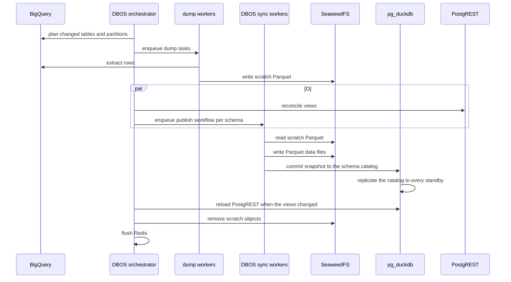
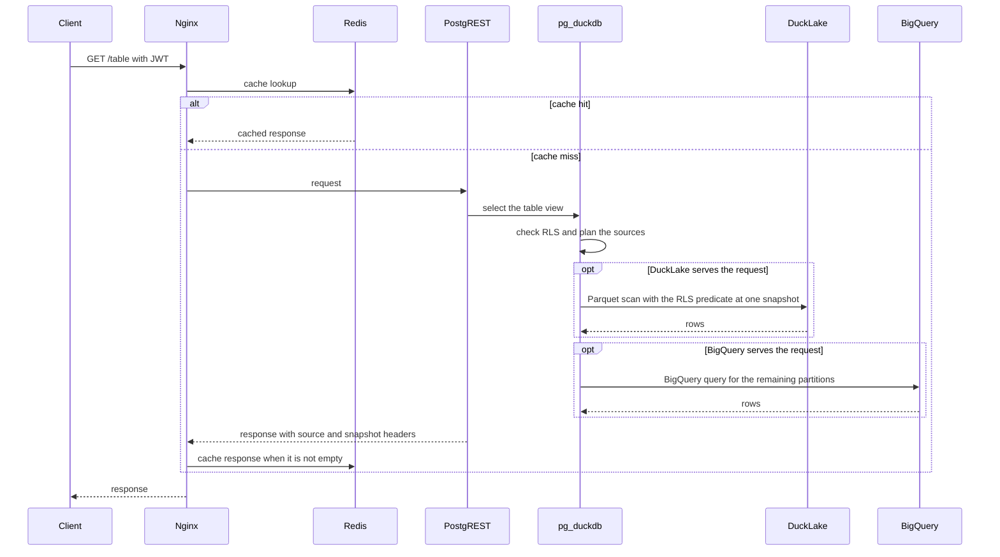

# Architecture

## Serving layer

Each PostgreSQL schema has one configured ingestion source. BigQuery is the default and current source. The sync service extracts source data to Parquet in SeaweedFS. DuckLake stores the table metadata in one catalog per PostgreSQL schema, in the `ducklake` database of the CNPG cluster, and stores table data as Parquet in SeaweedFS.

PostgreSQL stores metadata only:

- roles and grants;
- `access_policy` and `access_log`;
- PostgreSQL views and `SECURITY DEFINER` functions;
- DBOS workflow state.

PostgREST reads one view per table. The view calls a function that checks the access policy, plans DuckLake and the optional configured-source partition fallback from `data_proxy.state`, and reads them. The function passes the access-policy predicate to DuckDB, so the Parquet scan reads only authorized rows. PostgREST query filters aren't pushed into DuckDB. PostgreSQL applies them after the function returns the authorized rows.

The proxy and Redis handle response caching. The read order is:

```text
Redis cache
→ PostgREST table view (DuckLake, and each configured fallback source in order)
→ Redis cache result, when the answer is not empty
```

See [Proxy](proxy.md) for the routing rules and the cache.

## Catalog database

The catalogs live in the `ducklake` database of the CNPG cluster. Each schema has a metadata schema with the same name, so one database holds every catalog. Two roles use it:

| Role | Used by | Access |
| --- | --- | --- |
| `ops` | DBOS sync workers, through the `-rw` Service | Owns the database and creates the metadata schemas. |
| `duckdb` | `pg_duckdb` in every PostgreSQL instance | Reads every metadata schema. Can't write. |

```text
DuckLake writer (sync worker)
→ primary: database ducklake, metadata schema <schema>
→ CNPG streaming replication
→ every standby: its own copy of the catalog
```

Each `pg_duckdb` backend attaches the catalog of its own instance through `localhost`. The DuckDB secrets `ducklake_catalog_pg` (the PostgreSQL login of the catalog) and `ducklake_catalog` (the catalog itself) hold the address and the credentials. The `configure-db` Job creates them as persistent secrets in the shared folder `/duckdb/secrets`. A standby reads its own replicated copy, so a read doesn't depend on the primary. A backend that attached earlier sees a new snapshot at the start of its next query, so nothing refreshes the readers and nothing restarts the Poolers.

The same Job sets default privileges in the `ducklake` database. The `duckdb` role can read every metadata schema that `ops` creates later.

The writer writes the Parquet files to SeaweedFS before it commits the snapshot, so a catalog never points at a missing file. A standby can be a few seconds behind the primary, and snapshot expiration (`DUCKLAKE_SNAPSHOT_EXPIRATION`, 7 days by default) keeps the files that an older snapshot uses. The CNPG backups cover the catalogs.

There is one active writer per schema catalog. Publishing is parallel across schemas and sequential within each schema. One `publish` queue serves all schemas, and the schema name is its partition key, so a new schema needs no new queue.

## Sync service

| Component | Work | Result |
| --- | --- | --- |
| `run_sync` | Plans changed tables and partitions. | Enqueues dump and publish workflows. |
| `dump_task` | Extracts ingestion-source data. | Writes independent scratch Parquet files. |
| `seed_schemas` | Reconciles PostgreSQL functions and views. | Returns whether the view set changed. |
| `publish_schema` | Inserts scratch Parquet into the schema catalog. | The commit creates a snapshot that every instance sees after replication. |
| `apply_ducklake_maintenance` | Runs inside `publish_schema` on the schema writer after a publication. | Expires old snapshots, compacts files, and removes old and orphaned Parquet files. |
| `finalize_run` | Clears scratch objects and Redis. | Keeps the DuckLake data prefix intact. |

Seed and publish run concurrently. When a view is added or removed, the workflow tells PostgREST to reload its schema after every publisher finishes, because PostgREST caches the schema. The database first waits until every standby replayed the change, so a reload never reads an old schema. A new snapshot alone reloads nothing.

## Sync sequence



## Kubernetes topology

The chart deploys one CNPG cluster with a primary and at least one standby, one PgDog workload, one PostgREST workload, and one proxy workload. See [Helm Chart](helm_chart.md#topology). KEDA scales the DBOS sync workers. PostgreSQL replicas transfer metadata, including the catalogs, through normal CNPG WAL; they don't receive application table rows.

The sync ServiceAccount can list pods and nothing else. The workflow recovery needs that.

## Request sequence



---

[Home](../README.md) · [Next →](sync.md)
