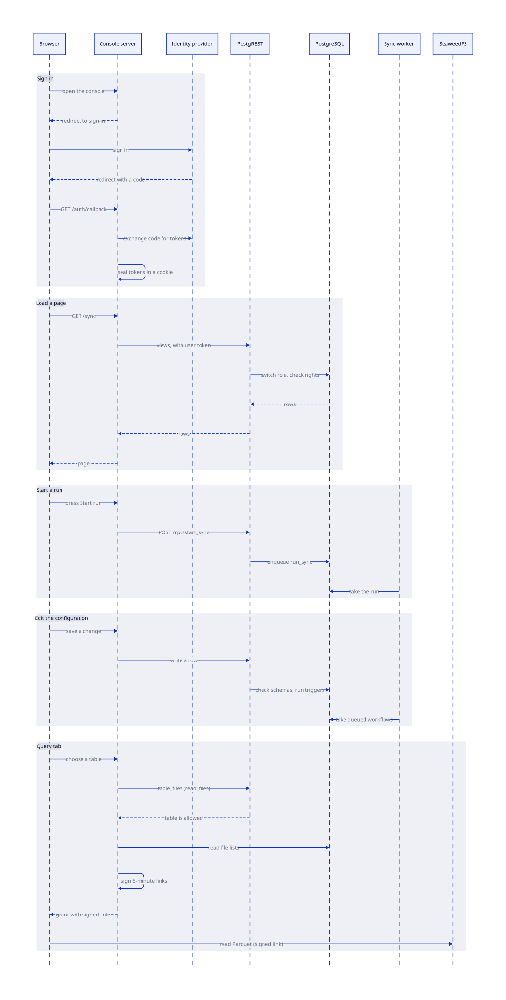
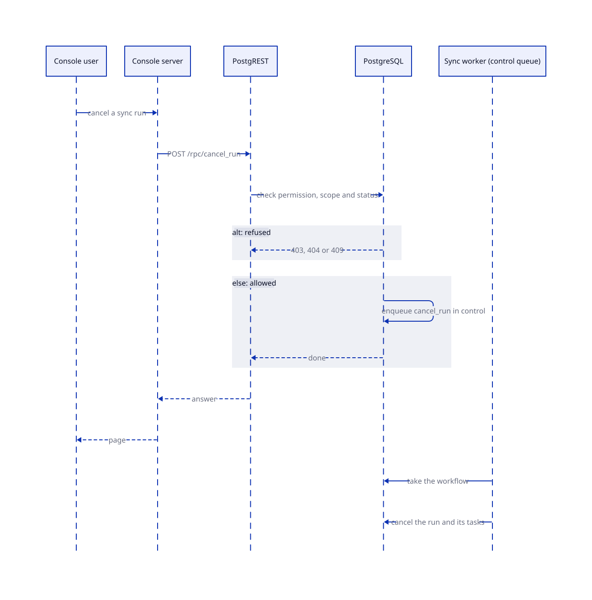

# Console layer

The console shows the system to people and changes its configuration. It's a web app with a database as its API. The browser never calls PostgREST, and the SvelteKit server calls it with the token of the user.

## Parts

| Part | Work |
| --- | --- |
| Console server | Signs people in, keeps the session, and calls PostgREST. It also signs the file links of the query tab. |
| Notebook site | A static site on its own origin. It runs the notebook of the query tab in the browser. |
| Identity provider | Signs people in and issues the tokens. |
| PostgREST | Serves the `console` schema as an API. |
| `console` schema | The views, the functions and the configuration tables. The database checks every permission. |
| Sync worker | Takes the workflows that the console queues. A worker that listens to the `control` queue runs the control actions. |
| `ducklake` database | The console reads the file lists, and it stores the sealed storage secrets in `signer.keys`. |
| SeaweedFS | Holds the Parquet files. The console creates one storage identity for each schema. |

## Console sequence

The diagram shows how the console works for a user. It covers signing in, loading a page, starting a sync run, editing the configuration, and using the query tab.

See [Console](../console/index.md) for the pages of the app and its database views.

## Run control

A console user can cancel a sync run. The same path serves resume and the schedule actions. The console never changes a workflow itself. The database function checks the permission, the schemas and the status, and then it queues a workflow in the `control` queue. A sync worker runs that workflow with the DBOS API.

See [Control a run and a schedule](../console/runs.md) for the allowed statuses and the error codes.

<!-- nav:start -->
---

[Previous: Sync layer](sync.md) | [Next: Sync](../sync.md) | [Index](index.md) | [Home](../index.md)
<!-- nav:end -->
