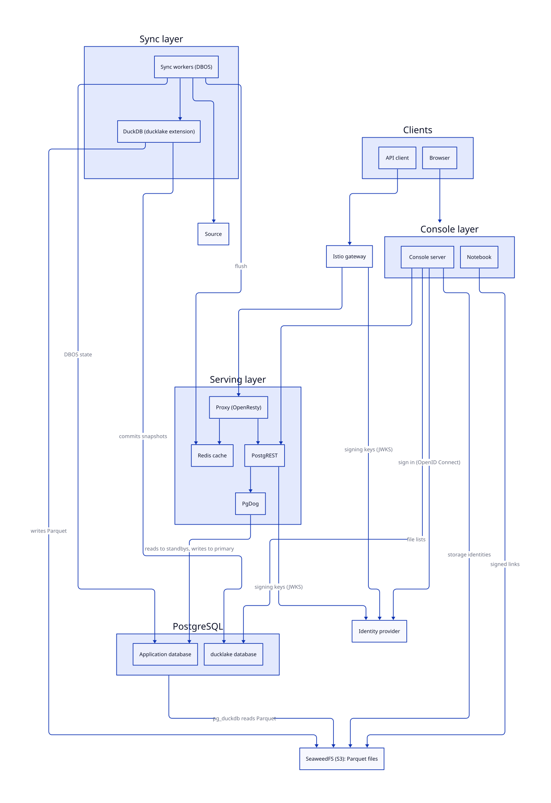

# Architecture

Data Proxy serves source data from PostgreSQL through DuckLake catalogs, and a sync service keeps those catalogs up to date. The [Glossary](../glossary.md) defines the terms, and its [Tools table](../glossary.md#tools) says what each tool does.

## Components

The diagram shows what each component needs. KEDA (Kubernetes Event-driven Autoscaling) scales the proxy, PostgREST, the sync workers and the PostgreSQL standbys.

## Layers

| Layer   | What it does                                                                                                   | Page                        |
| ------- | -------------------------------------------------------------------------------------------------------------- | --------------------------- |
| Serving | Answers API reads. It checks the token, uses the cache, and reads only the rows that the access policy allows. | [Serving layer](serving.md) |
| Sync    | Copies source tables into DuckLake and keeps the PostgreSQL views in step.                                     | [Sync layer](sync.md)       |
| Console | Shows the system to people and changes the configuration. It starts and controls sync runs.                    | [Console layer](console.md) |

PostgreSQL stores metadata only:

- roles and grants
- `access_policy` and `access_log`
- PostgreSQL views and `SECURITY DEFINER` functions
- DBOS workflow state

The table data is in DuckLake. PostgreSQL doesn't contain application data rows.

## Authentication

Each boundary has its own credential. The table lists who proves what, and where the details are.

| Boundary                    | Credential and check                                                                                                                         | Details                                        |
| --------------------------- | -------------------------------------------------------------------------------------------------------------------------------------------- | ---------------------------------------------- |
| API client to gateway       | A bearer JSON Web Token (JWT). The gateway checks the signature with the JWKS of the identity provider, and the issuer, audience and expiry. | [Identity provider](../security/identity.md)   |
| Browser to console          | The OpenID Connect authorization code flow with PKCE. The console keeps the tokens in an encrypted `httpOnly` cookie.                        | [Application](../console/app.md)               |
| Console server to PostgREST | The access token of the user. The browser never calls PostgREST.                                                                             | [Application](../console/app.md)               |
| PostgREST to PostgreSQL     | PostgREST validates the signature with `postgrest.jwksUri`. It connects as the `serving` login.                                              | [Authorization flow](../security/flow.md)      |
| Sync workers to PostgreSQL  | The `ops` login.                                                                                                                             | [Database Schema](../database.md#roles)        |
| PostgreSQL to SeaweedFS     | The DuckDB S3 secret, which `configure-db` writes.                                                                                           | [Serving layer](serving.md#ducklake-read-path) |
| Sync workers to the source  | The credentials of the source, such as `GOOGLE_APPLICATION_CREDENTIALS` for BigQuery or Workload Identity.                                   | [Environment](../operations/environment.md)    |
| Notebook to SeaweedFS       | A signed link for one object, for `GET` only, valid for 5 minutes.                                                                           | [Query tab](../console/query.md)               |

The token proves who the caller is. A token lives 5 minutes, and a role change takes effect with the next token. See [Identity provider](../security/identity.md) and [Tokens](../security/tokens.md).

## Authorization

The database decides what the caller may do, so no layer above it calculates permissions. The table lists each decision and what makes it.

| Decision                   | What decides it                                                                                           | Details                                                      |
| -------------------------- | --------------------------------------------------------------------------------------------------------- | ------------------------------------------------------------ |
| The role                   | PostgREST switches to the database role of the `role` claim. `rbac.toml` gives that role its permissions. | [Roles](../security/roles.md)                                |
| The schemas                | The `schemas` claim limits the schemas that a token reaches.                                              | [Permissions](../security/permissions.md)                    |
| The rows                   | The access policy matches the subject and the unit. The table function passes the predicate to DuckDB.    | [Schema and row authorization](../security/authorization.md) |
| A console action           | The database function checks the permission, the schemas and the status.                                  | [Control a run and a schedule](../console/runs.md)           |
| The files of the query tab | `read_files`, the schema, a catalog role and a signed link.                                               | [Query tab scope](../console/scope.md)                       |

The cache key includes the role, so a token with another role never reads an answer that another token cached.

## DuckLake pieces

DuckLake has six pieces. Each piece lives in one place, and one layer writes it.

| Piece                 | Where it lives                                                            | Written by                                  | Read by                                                                                  |
| --------------------- | ------------------------------------------------------------------------- | ------------------------------------------- | ---------------------------------------------------------------------------------------- |
| Catalog               | The `ducklake` database, with one metadata schema for each source schema. | The sync workers, as `ops`, on the primary. | `pg_duckdb` in every PostgreSQL instance, as `duckdb`. The console reads the file lists. |
| Data files            | SeaweedFS, under `s3://<bucket>/ducklake/<schema>/`.                      | The sync workers.                           | `pg_duckdb`. The notebooks read them through signed links.                               |
| `pg_duckdb`           | An extension inside every PostgreSQL instance.                            | The image installs it.                      | The table functions of PostgREST views.                                                  |
| DuckDB in the workers | The sync worker process, with the DuckLake extension.                     | None.                                       | The publish step uses it to commit snapshots.                                            |
| DuckDB secrets        | The shared volume `<release>-duckdb`, in `/duckdb/secrets`.               | The `configure-db` Job, on the primary.     | Every PostgreSQL instance.                                                               |
| Signer keys           | The table `signer.keys` in the `ducklake` database.                       | The console.                                | The console, to sign file links.                                                         |

See [Data model](../model.md) for the tables.

## Kubernetes

The chart deploys one CloudNativePG (CNPG) cluster with a primary and at least one standby, one PgDog workload, one PostgREST workload, and one proxy workload. See [Topology](../operations/topology.md).

<!-- nav:start -->
---

[Previous: Data Proxy](../index.md) | [Next: Serving layer](serving.md) | [Home](../index.md)
<!-- nav:end -->
