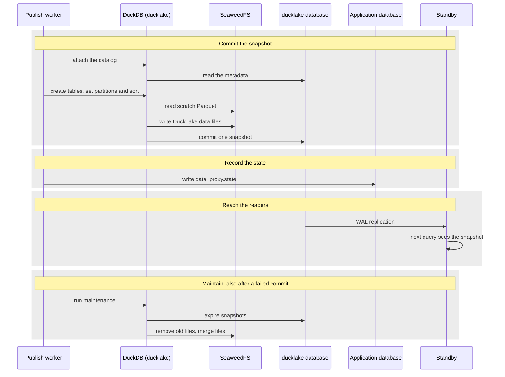

# DuckLake write path

This page shows how the sync layer writes the data of a schema to its DuckLake catalog. [Sync layer](./sync.md) shows the whole sync run.

A publish worker commits one schema at a time. It uses DuckDB with the DuckLake extension.

- **One writer for each schema:** publishing is parallel across schemas and sequential within each schema. One `publish` queue serves all schemas, and the schema name is its partition key. A new schema needs no new queue.
- **Files first:** the writer writes the Parquet files before it commits the snapshot.
- **State after each table:** the writer saves the signature of a table right after the commit of that table. A failed publish keeps the tables that committed, and the next run skips them.
- **Retry:** a commit retries while the catalog is locked. `DUCKLAKE_COMMIT_MAX_ATTEMPTS` and `DUCKLAKE_COMMIT_RETRY_SECONDS` set the limit.
- **Maintenance:** it runs after each commit of a schema, also when the commit publishes nothing or fails. A full storage fails every commit, and only the maintenance deletes the files that free it. A schema with a change that didn't commit stays in the plan, so each run of the schema maintains it again. The maintenance removes the old files before it merges, because a merge writes files. A maintenance error is logged and doesn't stop the sync run. A commit error still fails the run after the maintenance.
- **Retention:** `DUCKLAKE_SNAPSHOT_EXPIRATION` (7 days by default) keeps the files that an older snapshot uses. The CNPG backups cover the catalogs.

See [DuckLake read path](./serving.md#ducklake-read-path) for how a catalog reaches the readers.

<!-- nav:start -->
---

[Previous: Sync layer](./sync.md) | [Next: Console layer](./console.md) | [Index](./index.md) | [Home](../index.md)
<!-- nav:end -->
