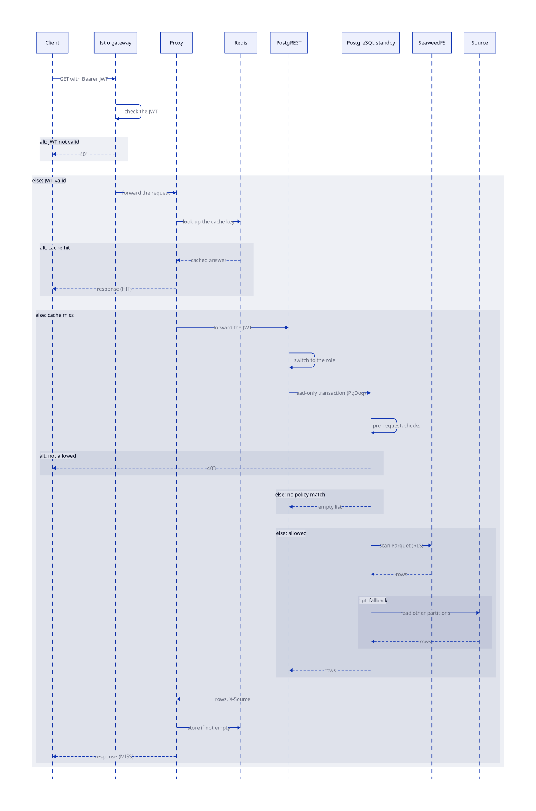

# Serving layer

The serving layer answers API reads. It checks the token, uses the cache, and reads only the rows that the access policy allows.

## Parts

| Part | Work |
| --- | --- |
| Istio gateway | Checks the JSON Web Token (JWT) signature, issuer and audience. |
| Proxy | Looks up the cache, sends the filter to the database, and retries a failed read. See [Proxy](../proxy/index.md). |
| Redis | Stores the cached answers. Redis is a cache and never a source of truth. |
| PostgREST | Switches to the database role of the token, runs `pre_request`, and reads one view for each table. |
| PgDog | Pools the connections and routes each transaction. See [What PgDog does](#what-pgdog-does). |
| PostgreSQL standby | Runs the table views and the `SECURITY DEFINER` functions. |
| `pg_duckdb` | Runs DuckDB inside PostgreSQL. It reads the DuckLake catalog and the Parquet files. |

## Request sequence

The diagram shows one API read, from the JWT check at the gateway to the cached answer. It covers the cache, the role switch, the row-level security checks, the DuckLake scan, and the fallback to the source.

The table view calls a function that checks the access policy. The function plans DuckLake and the optional partition fallback from `data_proxy.state`, and it reads them in order. It passes the access policy predicate to DuckDB, so the Parquet scan returns only authorized rows. PostgREST filters aren't pushed into DuckDB. PostgreSQL applies them after the function returns the authorized rows.

An aggregate select is the exception: the proxy calls the aggregate function of the table, and DuckDB runs the `GROUP BY`. See [Query pushdown](../proxy/pushdown.md#aggregates).

## What PgDog does

PgDog is a connection pooler between PostgREST and PostgreSQL. It runs `pgdog.replicas` pods (two by default) and has no scaler.

| Traffic | Goes to | Why |
| --- | --- | --- |
| A read-only transaction (each `GET`) | A standby, through the `-ro` Service | Reads spread over the standbys. |
| Any other transaction (a write or a function call) | The primary, through the `-rw` Service | Only the primary accepts writes. |
| The `LISTEN` connection of PostgREST | The primary | PgDog never gives a read/write session, so PostgREST connects to the `-rw` Service itself. |
| A read while no standby can serve | The primary | The read still succeeds. |

PgDog pools transactions, so many PostgREST connections share a few PostgreSQL backends. The pool uses the `serving` login. PgDog doesn't measure the lag of a standby. CNPG takes a standby that's behind `cnpg.maxReplicaLag` out of the `-ro` Service. See [Topology](../operations/topology.md) for the failure behavior.

## DuckLake read path

Each PostgreSQL schema has one DuckLake catalog. The catalog is a metadata schema with the same name, in the `ducklake` database of the CNPG cluster. Two roles use the database:

| Role | Used by | Access |
| --- | --- | --- |
| `ops` | The sync workers, through the `-rw` Service. | Owns the database and creates the metadata schemas. |
| `duckdb` | `pg_duckdb` in every PostgreSQL instance. | Reads every metadata schema. Can't write. |

A catalog reaches the readers in this order:

1. The writer (a sync worker) commits a snapshot to the primary.
2. CNPG streaming replication copies the catalog to every standby.
3. A `pg_duckdb` backend attaches the catalog of its own instance through `localhost`.

A backend that attached earlier sees a new snapshot at the start of its next query. Nothing refreshes the readers, and nothing restarts PgDog.

The DuckDB secrets `ducklake_catalog_pg` (the PostgreSQL login of the catalog) and `ducklake_catalog` (the catalog itself) contain the address and the credentials. The `configure-db` Job writes them as persistent secrets to the shared volume. The same Job sets default privileges, so `duckdb` can read every metadata schema that `ops` creates later.

The writer writes the Parquet files before it commits the snapshot, so a catalog never points at a missing file. A standby can be a few seconds behind the primary. Snapshot expiration keeps the files that an older snapshot uses. See [Sync layer](sync.md#ducklake-write-path).

<!-- nav:start -->
---

[Previous: Architecture](index.md) | [Next: Sync layer](sync.md) | [Index](index.md) | [Home](../index.md)
<!-- nav:end -->
