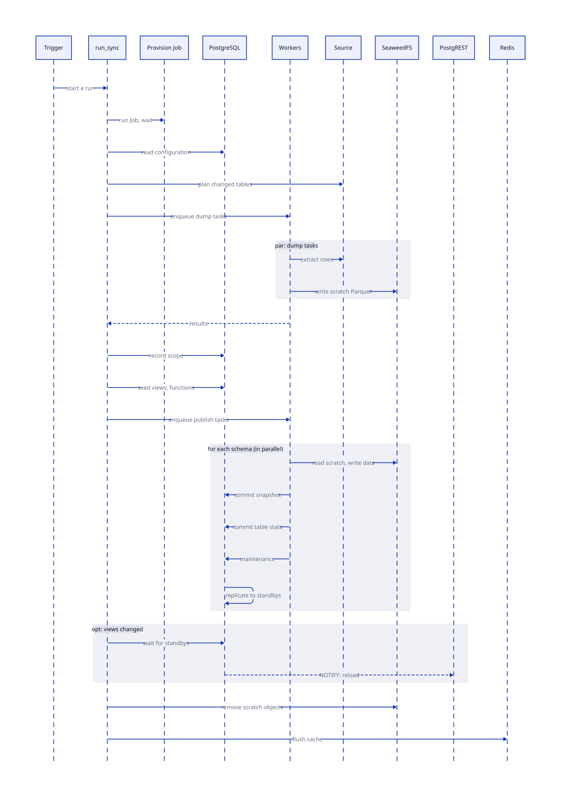
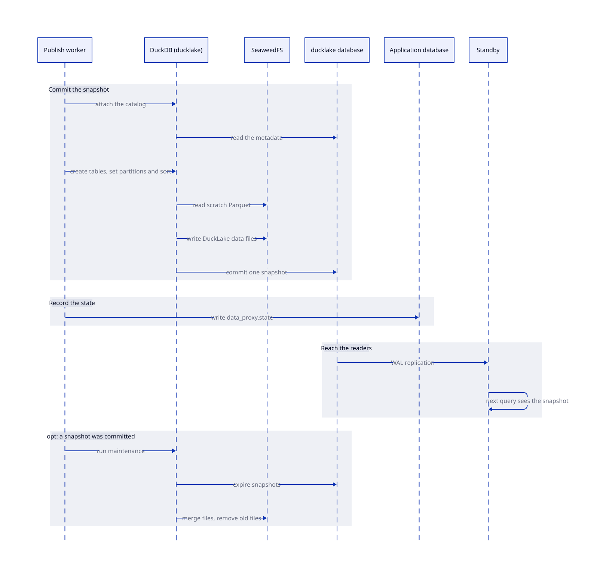

# Sync layer

The sync layer copies the tables of the source into DuckLake. It also keeps the PostgreSQL views, the cache and the proxy settings in step with the data. The layer is a set of DBOS workflows. [Sync](../sync.md) describes its configuration.

## Workflows

Each row of the table names one workflow or step, its work, and its result.

| Component | Work | Result |
| --- | --- | --- |
| `run_sync` | Plans changed tables and partitions. | Enqueues dump and publish workflows. |
| `dump_task` | Extracts source data. | Writes independent scratch Parquet files. |
| `seed_schemas` | Reconciles the PostgreSQL functions and views of every table in a planned schema, and rebuilds the tables whose stored signature changed. | Returns whether the view set changed. |
| `reconcile_idle_schemas` | Reconciles the PostgreSQL functions and views of the scope when the plan has no change. | Returns whether the view set changed. |
| `publish_schema` | Inserts scratch Parquet into the schema catalog. | The commit creates a snapshot that every instance sees after replication. |
| `apply_ducklake_maintenance` | Runs inside `publish_schema` after a publication. | Expires old snapshots, merges files, and removes old and orphaned Parquet files. |
| `finalize_run` | Clears the scratch objects and the cache. | Keeps the DuckLake data prefix intact. |

A run without a data change still reconciles the views of its scope. Each view stores the signature of its generated definition, so the step rebuilds only a table whose definition changed. This is how a new release reaches a table that didn't change. A run that dumps some tables does the same for every table of its planned schemas, so one run applies a release. The step reads the column types of each table from the source, so each run costs one lookup for each table of the schema. It doesn't dump, publish or clear the cache.

Seed and publish run concurrently. When a view is added or removed, the workflow tells PostgREST to reload its schema after every publisher finishes. The database first waits until every standby replayed the change. A new snapshot alone reloads nothing.

## Run log

Each workflow writes its log lines to a DBOS stream, and the console shows the lines of every workflow of a run in one list. A line carries the schema and the table of its workflow, so the console filters by table.

A dump task writes these lines:

| Line | Fields |
| --- | --- |
| `Dump started` | `task_id` |
| `Extraction started` | `task_id`, `paths` |
| `Source described` | `task_id`, `columns` |
| `Partition written` | `task_id`, `path`, `part`, `of`, `rows`, `bytes`, `seconds` |
| `Extraction attempt failed` | `task_id`, `error`. It's a warning, and each retry of the step writes one. |
| `Extraction completed`, `Dump completed` | `task_id`, and `status` for the second line. |

A publish writes `Publish started`, `DuckLake commit started`, one `Table published` for each table, and `DuckLake commit completed` with `published_tables`, `failed_paths` and `snapshot_id`.

## Scaling and access

KEDA reads the length of the DBOS queues in the application database and scales the sync workers. The sync ServiceAccount can read pods and CronJobs, and it can create and watch Jobs, in its namespace. It has no other rights. The workflow recovery needs the pod list, and the provision step needs the CronJob and the Jobs.

## Sync sequence

The diagram shows one sync run, from the start to the cleanup. It covers provisioning, planning, the dump tasks, seeding the views, publishing each schema, and the reload of PostgREST.

## DuckLake write path

A publish worker commits one schema at a time. It uses DuckDB with the DuckLake extension.

- **One writer for each schema:** publishing is parallel across schemas and sequential within each schema. One `publish` queue serves all schemas, and the schema name is its partition key. A new schema needs no new queue.
- **Files first:** the writer writes the Parquet files before it commits the snapshot.
- **State after each table:** the writer saves the signature of a table right after the commit of that table. A failed publish keeps the tables that committed, and the next run skips them.
- **Retry:** a commit retries while the catalog is locked. `DUCKLAKE_COMMIT_MAX_ATTEMPTS` and `DUCKLAKE_COMMIT_RETRY_SECONDS` set the limit.
- **Maintenance:** it runs only after a commit made a snapshot. A maintenance error is logged and doesn't stop the sync run.
- **Retention:** `DUCKLAKE_SNAPSHOT_EXPIRATION` (7 days by default) keeps the files that an older snapshot uses. The CNPG backups cover the catalogs.

See [DuckLake read path](serving.md#ducklake-read-path) for how a catalog reaches the readers.

<!-- nav:start -->
---

[Previous: Serving layer](serving.md) | [Next: Console layer](console.md) | [Index](index.md) | [Home](../index.md)
<!-- nav:end -->
