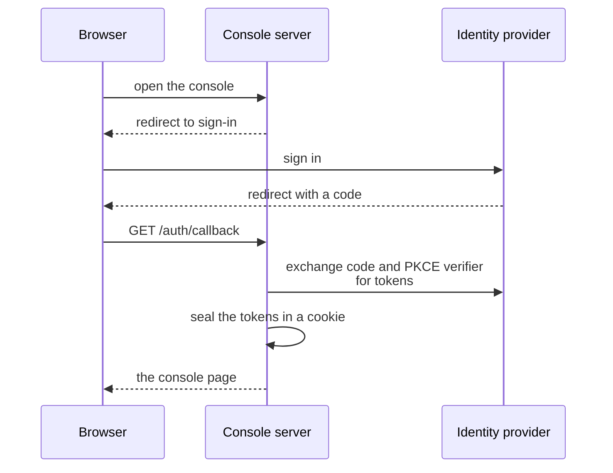

# Application

This page explains how the console app signs people in, keeps the session and shows its pages. Read it before you change `console/ui/`.

## The web app

The app signs in people with OpenID Connect: the authorization code flow with PKCE and a `state` value. The server keeps the access token and the refresh token in an encrypted cookie. The cookie is `httpOnly`, `SameSite=Lax` and host-only.

The token is too long for one cookie, so the server splits the sealed value into pieces of 3500 characters. The server refreshes the token 60 seconds before it expires, and a failed refresh sends the user back to the sign-in page. Every request that changes data must come from the origin of the console, or the server answers 403.

`GET /rpc/permissions` decides which tabs and buttons the user sees, and the database still checks every call. A token with no `role` claim shows the no-access page. The database takes it for an anonymous request, and a new sign-in would give the same token. The routes are `/sync`, `/sync/runs/<id>`, `/config`, `/access` and `/query`.

Each tab needs one permission to open, and it shows an action only if the user has its permission:

| Tab | Route | Needs | Actions need | Data |
| --- | --- | --- | --- | --- |
| Sync | `/sync` | `read_sync` | `start_sync`, `control_sync` | The views `runs`, `tasks`, `steps`, `logs`, `errors`, `overview`, `queues` and `schedules` (one schedule for each schema, with an Edit dialog for its cron). |
| Config | `/config` | `read_config` | `create_config`, `edit_config`, `delete_config`, `import_config` | The tables `schemas`, `tables` and `rls`, the history, and the import preview. |
| Access | `/access` | `read_policy` | `create_policy`, `edit_policy`, `delete_policy` | `access_policy` and `access_log` of one schema. |
| Query | `/query` | `read_files` | None | The file lists of a table and the signed links. |

The app has these routes besides the tab pages. Every route sits under the path `/console` of the API host, so `/healthz` is `/console/healthz`. Every request that changes data also needs the console origin, as described above.

| Route | Method | Sign-in | Work |
| --- | --- | --- | --- |
| `/auth/login` | GET | No | Makes a PKCE pair and a `state`, stores them in a cookie for ten minutes, and redirects to the identity provider. The query `next` names the page to open after the sign-in. The default is `/sync`. |
| `/auth/callback` | GET | No | Checks the `state`, exchanges the code, writes the session cookie, and redirects to `next`. The cookies use the path `/console`, so the browser doesn't send them to the API. It accepts only a path on the console. It answers 400 when the answer doesn't match the request. |
| `/auth/logout` | POST | No | Deletes the session cookie. It redirects to the end-session address of the identity provider, or to `/auth/login` when the provider has none. |
| `/config/export` | GET | Yes | Downloads `sync.json`, which `console.sync_config()` builds from the rows that the user may read. |
| `/query/grant` | POST | Yes | Takes `{schema, tables}` and returns the signed links for the files of those tables. It needs `read_files` and the schema, which `console.table_files()` checks. It answers 503 when the query tab isn't set up. |
| `/sync/runs/<id>/logs` | GET | Yes | Streams the status and the new log lines of the run as server-sent events, one read each second, until the sync run finishes or the page leaves. The query `after`, or the header `Last-Event-ID` of a reconnect, limits the lines to a later time. The query `settle` keeps the stream open for 30 seconds after the status finishes, because a resume or a retry may follow. It answers 404 for an unknown run. |
| `/healthz` | GET | No | Answers `ok`. The probes of the Deployment use it. |

The code of the app is in `console/ui/src`:

- `lib/server/` contains the session, the OpenID Connect client, the PostgREST client, the catalog reader and the signer.
- `lib/types.ts` contains the types of the rows. Write the types by hand. Update them in the same commit that changes a view.

The Config page edits a row in a dialog:

- A schema has a `claim` and `encrypted`.
- A table has a strategy, `n`, `fallback`, a cache TTL (time to live) and sort columns.
- A row rule has a column and a unit type.

The page doesn't edit `partitioning`. Change it with an import of the document.

[Console lists, feedback and tokens](feedback.md) describes the lists, the feedback, the live data and the tokens from the identity provider.

<!-- nav:start -->
---

[Previous: Console](index.md) | [Next: Console lists, feedback and tokens](feedback.md) | [Index](index.md) | [Home](../index.md)
<!-- nav:end -->
