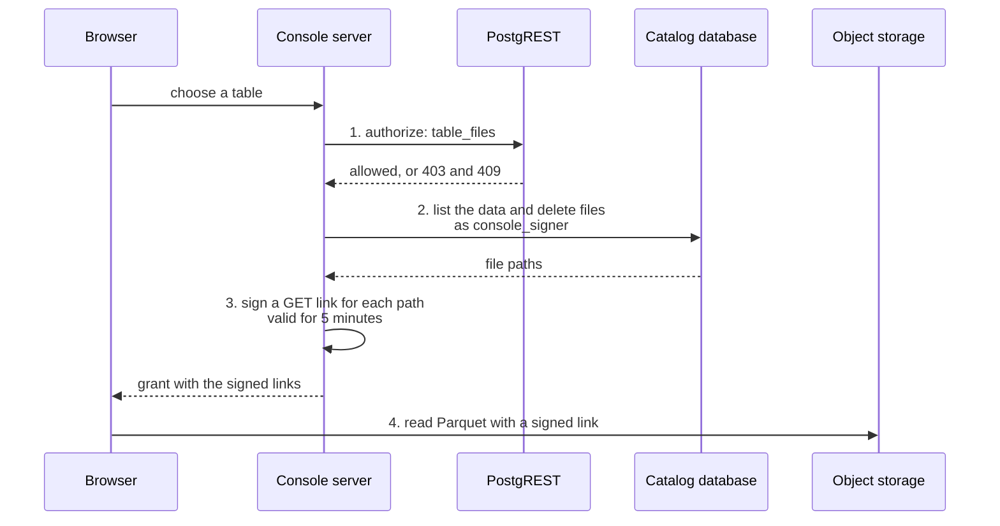

# Query tab

This page explains how the Query tab gives a user a notebook for the synced data. It also says how the grant of signed links works and what limits the links to one schema.

## The notebook

A role with `read_files` queries the synced data in a notebook in the browser. The notebook is a marimo export that runs Python (Pyodide) and DuckDB compiled to WebAssembly. The files stay in object storage, and the browser reads them directly.

The notebook runs on its own origin, `notebooks.<domain>`, which is a different site from the console, and the console page embeds it in an `iframe`. The notebook has no token and no cookie of the console. The page opens it with the chosen tables in the address, and the notebook shows one cell for each table ([Notebooks](../notebooks.md)).

## How a grant works

The grant that the console server builds for one schema has four steps, which the diagram shows:

1. **Authorize.** The server calls `GET /rpc/table_files?schema_name=<schema>&table_name=<source table>` with the token of the user. `console.table_files` needs `read_files` and checks the schemas of the token.
   - It answers 403 for a schema or a table outside the schemas, for a name that doesn't exist and for a token without the permission.
   - It answers 409 for a schema with encrypted files, because the browser has no key.
2. **List.** The server connects to the catalog database with the `console_signer` login and runs `SET LOCAL ROLE schema_<name>` for the schema that step 1 authorized. That role reads the metadata of its schema only. The server reads the data files and the delete files of each table at the latest snapshot.
3. **Sign.** The server signs a `GET` link for each listed path, valid for 5 minutes. PostgREST can't sign links, so the database never contains storage credentials.
   - The credential is the identity of that schema. It's a user in the storage with a policy that allows `s3:GetObject` on the folder of the schema and nothing else.
   - The console makes the identity on the first query of the schema, through the IAM API of the storage, with an admin credential (`S3_ADMIN_ACCESS_KEY`, `S3_ADMIN_SECRET_KEY`).
   - The storage shows the secret of a key only once, so the console seals it and stores it in `signer.keys` in the catalog database.
   - An advisory lock keeps two replicas from making two keys.
   - Without the admin credential, every schema signs with one read-only credential. A storage that can't limit a credential to a prefix, such as GCS, does the same.
4. **Send.** The page sends `{ schema, tables, expiresAt }` to the notebook with `postMessage` and the exact origin of the notebook. It sends a new grant every 4 minutes. The notebook builds one view for each table. A data file with a delete file becomes an anti join that removes the deleted rows, so the counts match the database.

## What scopes the links

Three layers scope the links to one schema:

| Layer | What it checks | What it stops |
| --- | --- | --- |
| Application database | `read_files`, the schema in the `schemas` claim, that the table exists, and that the schema isn't encrypted. It verifies the token. | A user who asks for a schema outside the claim. |
| Catalog role | The role `schema_<name>` reads the metadata of its schema only. | The console server that lists the files of another schema by mistake. |
| Signed links | A link works for one object and one signature. A credential limited to the prefix of a schema can't sign a key outside it. | A path that isn't in the list, a changed key, and a link for another file. |

The layers protect against a partial bug, such as a wrong table name or a path that a user supplies. They don't protect against a stolen console server, which stores the catalog login and the signing credentials. Only the application database verifies the token. The server must therefore call `table_files` first, and use the schema that it authorizes for the other two layers.

Row-level security doesn't apply to the files. A user with `read_files` reads every row of the tables of their schemas, and only `dp_admin` has `read_files`.

Every link is a `GET`. A `HEAD` request on a link signed for `GET` answers 403, and so does a changed signature. With one read-only credential, the first two layers are the only scope.

## Objects behind the grant

- `provision` creates the role `schema_<name>` with the schema and drops it with the schema. The role has no login. It reads the metadata schema of its schema, now and for the tables that DuckLake creates later.
- `configure-db` creates the `console_signer` login without inheritance, with its password in the Secret `<release>-signer`. The login is a member of every `schema_<name>` role and must switch into one.
- `configure-db` also creates `signer.keys` in the catalog database. Only that login reads and writes it, and the drop of a schema deletes its row.
- The step `cleanup_s3_credentials` deletes the identity `sig_<schema>` of a schema that left the configuration. It runs in `provision_schemas` and `cleanup_tables`, only when `S3_IDENTITIES` is `true`. The chart sets that with `console.storage.perSchemaIdentities`.

## Storage setup

The bucket needs a cross-origin resource sharing (CORS) rule for the notebook origin. The rule allows `GET`, `HEAD` and the `Range` header, and it exposes `Content-Length`, `Content-Range`, `ETag` and `Accept-Ranges`. Without `Content-Range`, DuckDB fails with the message No magic bytes found. Set `s3.bootstrap.corsOrigins`, and the bootstrap Job sets the rule through the S3 API. It skips a GCS endpoint, which needs its own command.

The notebook origin sends a Content Security Policy that allows only its own files and the storage host. [Notebooks](../notebooks.md) describes the build of the site.

<!-- nav:start -->
---

[Previous: Changes](./changes.md) | [Next: Style](../style.md) | [Index](./index.md) | [Home](../index.md)
<!-- nav:end -->
