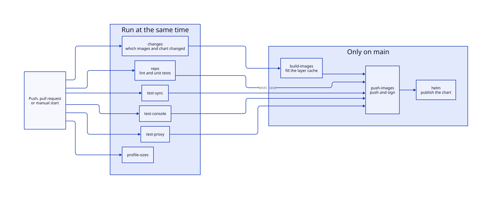

# CI and releases

The workflow `.github/workflows/ci.yaml` checks, tests, builds and releases. A second workflow, `sast.yaml`, runs the security scan. The scripts are in `scripts/ci.nu`. Run `ci` in the `chart` shell to call them.

## Triggers

The pipeline runs on a push to `main`, on a pull request and on a manual start. A push or a pull request starts it only when it changes a path of the list `ci_paths`. The list has the component folders, `nix/`, `k3d/`, `k6/`, `scripts/`, the workflows, the container files, the linter files and the devenv files. A change in `docs/` doesn't start it. A new run of a branch waits for the run before it, so two releases never overlap.

A manual start has two inputs. `force_checks` runs every check and test without the saved task state. `force_full` does the same, builds every image and starts the release job. The release job still needs a release-level commit and a change in the chart.

## Jobs

| Job | Work |
| --- | --- |
| `changes` | Runs `ci changes`. It writes which images need a build and whether the chart needs a release. |
| `repo` | Runs `repo:lint` and `repo:test:unit`. |
| `test-sync`, `test-console`, `test-proxy` | Run the `:int` task of the component in the `integration` profile. A task runs only if one of its inputs changed. |
| `profile-sizes` | Runs `nix:lint:closure` and `nix:lint:cmd`. No other job waits for it. |
| `build-images` | Builds each changed image and pushes nothing. It fills the layer cache while the tests run. |
| `push-images` | Waits for every test job. It builds each image again from the cache, pushes it and signs it, so no image of an untested commit reaches the registry. |
| `helm` | Releases the chart when the chart or an image changed. |

Each job restores the task state of the last green run of `main` before it runs, and only a run on `main` saves it. Caches keep the uv cache, the pnpm store and the Nix fetcher files between runs, keyed by the lock files. The workflow `cache-cleanup.yaml` deletes the caches of a deleted branch and of a closed pull request.

## Images

`ci changes` matches the changed files against the table `IMAGES` in `scripts/lib.nu`. Each image goes to `ghcr.io/<repository>-<name>` with the short commit hash and `latest` as tags. The PostgreSQL image adds the prefix `17-` to the hash.

| Image | Rebuilds when this changes |
| --- | --- |
| `data-proxy-sync` | `sync/src/`, `sync/pyproject.toml`, `sync/uv.lock`, `console/migrations/` |
| `data-proxy-proxy` | `proxy/src/`, `proxy/lux.toml`, `proxy/lux.lock` |
| `data-proxy-console` | `console/ui/`, `console/notebooks/` |
| `data-proxy-jobs`, `data-proxy-postgres` | The Containerfile of the image |

The k6 image is for the local cluster only.

## Chart releases

CI releases the Helm chart from Conventional Commits with `cog`. The settings are in `cog.toml`. `cog` reads the commit subjects since the last `helm-v*` tag. A type with `!` makes a major version, `feat` a minor version and `fix` a patch version. Other types make no release.

| Command | Work |
| --- | --- |
| `ci version` | Prints the next version, or says that no release is due. It changes nothing. |
| `ci guard` | Skips the release when no chart file changed since the last tag. |
| `ci images resolve`, `ci images pin` | Find the newest tag of each image and write the tags in `helm/values.yaml`, so a release never uses `latest`. |
| `ci release bump` | Runs `cog bump`. It sets the chart version, writes `CHANGELOG.md`, commits and tags. |
| `ci chart package`, `ci chart publish` | Package the chart and push it to the OCI registry. |
| `ci release push <tag>`, `ci release notes <tag>` | Push the commit and the tag in one push, and write the release notes. |

The chart is published before the push. A failed publish leaves no tag, so run the workflow again. A failed push leaves a published chart and no tag, and the next run publishes the same version again. If `main` is protected, add the secret `RELEASE_TOKEN` with a token that may push to it. Run `cog bump --auto --dry-run` to print the next tag without a change.

Only the last step is specific to GitHub (`gh release create`). `ci.nu` reads `CI_REPOSITORY`, `CI_REGISTRY`, `CI_REGISTRY_USER`, `CI_REGISTRY_TOKEN`, `CI_BOT_NAME`, `CI_BOT_EMAIL` and `CI_OUTPUT_FILE`, and it uses the GitHub Actions values when they're missing.

## Security scan

`sast.yaml` calls the shared action `prefeitura-rio/actions/sast`, which sends the code to SonarQube and the findings to DefectDojo. It needs the variables `SONARQUBE_URL` and `DEFECTDOJO_URL` and the secrets `SONARQUBE_TOKEN`, `DEFECTDOJO_TOKEN`, `TS_OAUTH_CLIENT_ID` and `TS_OAUTH_SECRET`. `sonar-project.properties` excludes the tooling and the tests.

The run on `main` fails at the SonarQube quality gate. The log doesn't name the condition, so read the project dashboard on the SonarQube server. Checkov reports five `CKV_SECRET_6` findings although `.checkov.yaml` skips that check, so the action may not read the file. Checkov also can't render the chart, because `redis.host` has no default.

The branch `main` has no branch protection and no rule set. A required check needs the job names of `ci.yaml`: `Lint and unit tests`, `Sync integration tests`, `Console integration tests` and `Proxy integration tests`.

<!-- nav:start -->
---

[Previous: Tests](tests.md) | [Next: Operations](../operations/index.md) | [Index](index.md) | [Home](../index.md)
<!-- nav:end -->
