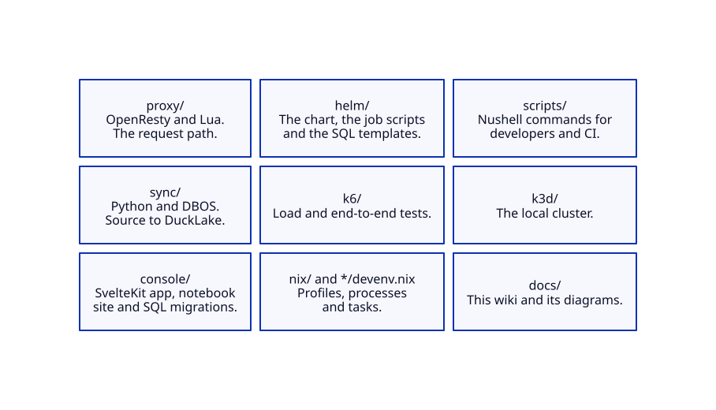

# Development

This section helps you set up the repository, run the checks and find your way in the code. [Tests](tests.md) says how to run each suite. [CI](ci.md) describes the pipeline and the release. [Style](../style.md) has the rules for the code and the docs.

## Code map



## Set up the local cluster

Install k3d, Podman, `kubectl`, Helm and the Google Cloud CLI. The Podman network needs DNS, and the shell that runs k3d needs the Docker-compatible socket variables of Podman.

```bash
devenv --profile default shell
gcloud auth application-default login
cluster up
```

`cluster up` stops before Helmfile when the application-default credentials are missing. It writes the credentials of the cluster to the ignored `k3d/.kubeconfig` and doesn't change your kubeconfig. It installs KEDA, k6, Istio, SeaweedFS, Keycloak, PostgreSQL with `pg_duckdb`, Valkey, PostgREST and Data Proxy.

| Command | Work |
| --- | --- |
| `cluster sync` | Applies the current local image tag. |
| `cluster sync --build` | Builds and pushes new local images, then applies them. |
| `cluster down` | Stops the cluster. Run `cluster down` and `cluster up` again when the Helm install fails. |
| `cluster` | Lists every command. |

`sync/` is one flat Python project. Its `pyproject.toml` has the settings of `ruff`, `pyrefly`, `complexipy`, `vulture` and `pytest`. `uv sync` prepares `sync/.venv`.

## How devenv sets up the repository

The root `devenv.yaml` imports the folders `proxy/`, `sync/`, `console/` and `helm/`. Each folder has a `devenv.nix` with the profiles of its component. Run a profile with `devenv --profile <name> <command>`, where the command is `shell`, `up`, `test` or `tasks run <task>`.

| Profile | Use |
| --- | --- |
| `default` | Everything that a developer needs: the three stacks, the docs and the cluster scripts. |
| `repo` | Every lint and unit task. The CI job `repo` runs it. |
| `sync-unit`, `proxy-unit`, `console-unit` | The lint and unit tasks of one component. |
| `sync`, `proxy`, `console` | One component with its test services, for `devenv test` and `devenv up`. |
| `integration` | The three `:int` tasks, which start the service profiles. |
| `chart` | Helm, `cog` and the `ci` script. |
| `nix` | The checks of the profile sizes and of the commands in the docs. |
| `base`, `python` | The parts that the other profiles share, in `nix/profiles/shared.nix`. |

A profile fetches every package that its tasks and processes name, so keep each one small. `nix:lint:closure` fails when a profile grows over its limit in `nix/profiles/nix.nix`. The processes of the test stack are in `nix/stack/`, the helpers in `nix/utils/`, and the ports, addresses and test logins in `nix/data.nix`. Task names follow `<component>:<verb>:<target>`, and devenv rejects a name that doesn't.

A task skips its work when its input files didn't change since the last green run. To force a run, change an input or delete `.devenv/profiles/<profile>/state/tasks.db`.

## Run the checks

```bash
devenv --profile repo tasks run repo:lint repo:test:unit
```

| Task | Checks |
| --- | --- |
| `sync:lint:py`, `sync:lint:sql` | Python and SQL: `ruff`, `pyrefly`, `complexipy`, `vulture`, `sqlfluff` and `goose validate`. |
| `proxy:lint:lua` | Lua: StyLua, luacheck and the LuaLS type check. |
| `console:lint:ui`, `nb:lint:ts` | The app and the notebooks: `svelte-check`, ESLint and Prettier. |
| `chart:lint:helm`, `chart:lint:toml` | The chart and `rbac.toml`. |
| `ci:lint:wf`, `ctr:lint:files`, `nu:lint:scripts` | Workflows, container files and Nushell scripts. |
| `docs:lint:code` | The style rules that a pattern can check, and the last 50 commit subjects. |
| `docs:lint:style`, `docs:lint:links`, `docs:lint:nav` | The style page, the links and the page order. |
| `nix:lint:closure`, `nix:lint:cmd` | The profile sizes and the `devenv` commands in the docs. |

The git hooks run when you commit. `eslint`, `prettier`, `lx-fmt`, `ruff` and `ruff-format` fix files, so stage the result and commit again. `ripsecrets` blocks a secret, and `vale` checks the prose of the docs. CI doesn't run Vale. Run `vale <file>` for a quick check.

Before a release, run the checks that CI can't run. `cluster k6 e2e` tests the whole system. `cluster k6 load` tests the latency gates and KEDA. `cluster upgrade --from <previous chart version>` tests the upgrade path, after the first release.

## Run the console locally

```bash
devenv --profile console up
```

The first start takes about one minute. Add `-d` to run in the background, wait with `devenv processes wait`, and stop with `devenv down`. Open `http://console.localhost:13001/console`, or run `devenv --profile console tasks run console:open:browser`. Sign in as `admin` (role `dp_admin`, schema `test`) with the password `admin`. The tests also use six users with the password `web-test`:

- `web_admin`: role `dp_admin`, schema `test`.
- `web_viewer`: role `dp_console`.
- `web_api`: role `dp_api`.
- `web_policy`: role `dp_policy`.
- `web_other`: role `dp_admin`, schema `other`.
- `web_root`: role `dp_admin`, every schema.

No sync worker runs, so a sync run that you start stays `ENQUEUED`. A worker for the queues `control` and `schedules` runs, so cancel, resume and the schedule actions work.

## Write the docs

`devenv --profile default tasks run docs:serve:site` renders the diagrams, writes the page footers and the sidebar, and serves the wiki at `http://127.0.0.1:18200`. The page order is in `docs/.nav.json`. Render the diagrams with `docs:build:diag`.

## Database migrations and the local API

The header of `scripts/migrate.nu` explains the migrations. Run `migrate up`, `migrate status` or `migrate down` in the console shell with `PG_DATABASE_URL` set. [Using the API](../using.md#try-it-locally) shows how to get a token and call the local API.

<!-- nav:start -->
---

[Previous: Style](../style.md) | [Next: Tests](tests.md) | [Home](../index.md)
<!-- nav:end -->
