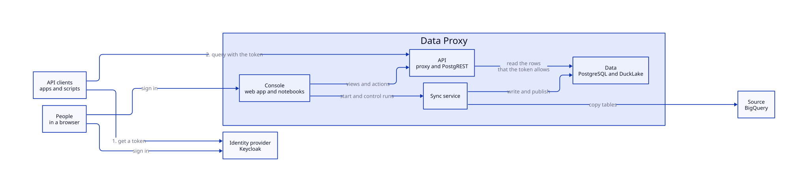

# Data Proxy

Data Proxy copies tables from a source, such as BigQuery, into PostgreSQL and serves them as a REST API. Each caller reads only the rows that its token and the access policy allow. This wiki explains how it works, how to use it and how to run it. The [Glossary](glossary.md) defines the terms.

## Find your page

| I want to | Read |
| --- | --- |
| Query the data | [Using the API](using.md) |
| Understand the parts and how they fit | [Architecture](architecture/index.md) |
| Add or change a synced table | [Sync](sync.md) and the [Console](console/index.md) |
| Decide who can read what | [Security](security/index.md) |
| Install, scale or back up the system | [Operations](operations/index.md) |
| Change the code | [Development](dev/index.md) and [Style](style.md) |
| Look up a word or a tool | [Glossary](glossary.md) |

## All pages

- [Architecture](architecture/index.md) — Components, authentication, authorization and DuckLake pieces.
  - [Serving layer](architecture/serving.md) — Answers API reads with the cache, PgDog and DuckLake.
  - [Sync layer](architecture/sync.md) — Copies source tables into DuckLake.
  - [Console layer](architecture/console.md) — The web app, its sign-in and the run control.
- [Sync](sync.md) — The `sync.json` settings, table strategies, partitions and DuckLake sort keys.
- [Using the API](using.md) — PostgREST profiles, queries and response headers.
- [Proxy](proxy/index.md) — Routing headers and identity-aware caching.
- [Database Schema](database.md) — PostgreSQL schemas, tables, access policies and DuckLake storage.
  - [Database roles and grants](grants.md) — The roles, the security of the functions, the pushdown of the predicates and S3 access.
- [Data model](model.md) — Diagrams of the tables, columns and keys.
- [Glossary](glossary.md) — The terms and the tools that the pages use.
- [Notebooks](notebooks.md) — The notebook site of the query tab.
- [SQL Templates](sql.md) — How the SQL templates are named, written and rendered.
- [Security](security/index.md) — JSON Web Token (JWT) claims, permissions, authorization, tokens and the identity provider.
- [Console](console/index.md) — The admin web app and its database views.
- [Style](style.md) — The rules for the code and the docs, one section for each area.
- [Development](dev/index.md) — Local setup, devenv, checks, tests and CI.
- [Operations](operations/index.md) — Helm chart, topology, settings, scaling, metrics and backups.

<!-- nav:start -->
---

[Next: Architecture](architecture/index.md)
<!-- nav:end -->
