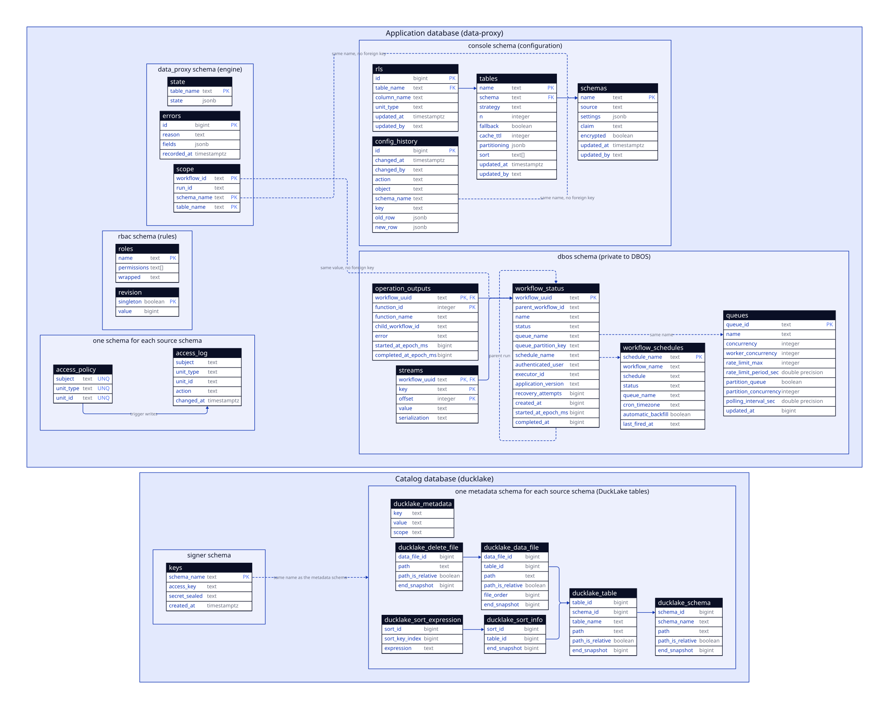
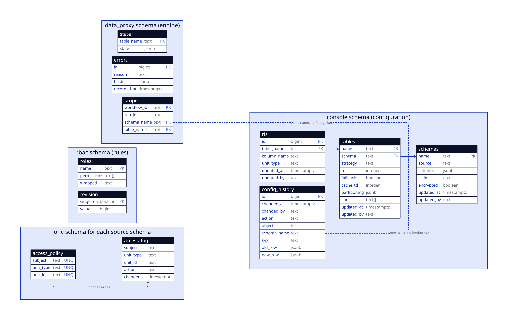
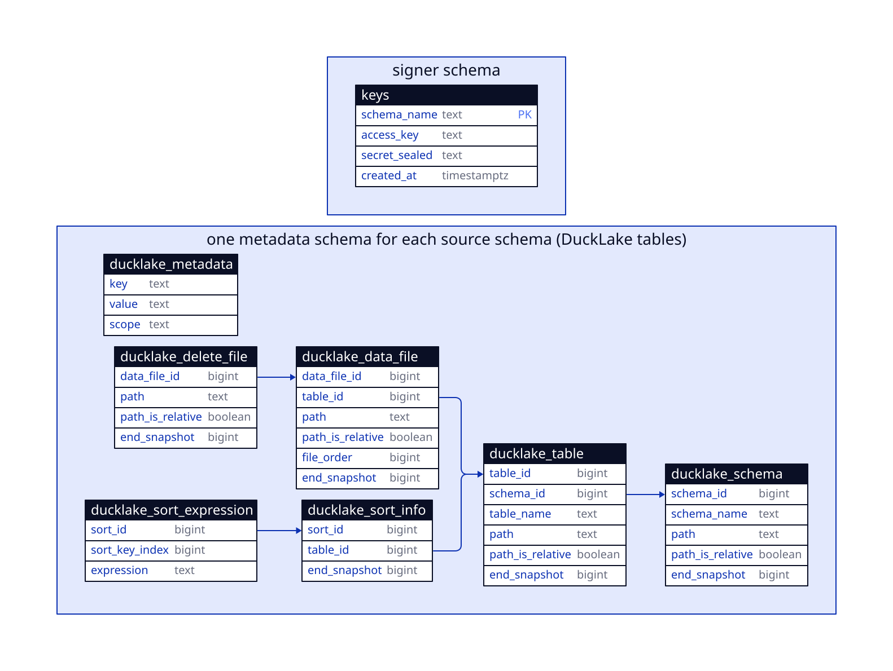
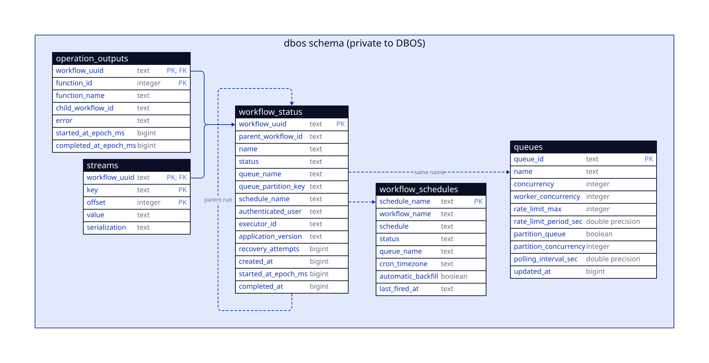

# Data model

This page shows the tables of the system. Each diagram has the columns that the code reads or writes. An arrow points from a column to the column that it references.

A solid arrow is a foreign key. A dashed arrow joins two columns with the same value and no foreign key. The diagrams show no views and no functions. See [Database Schema](database.md) for those.

## All tables

This diagram joins the three diagrams below. It also shows the two links between them: `data_proxy.scope` to `dbos.workflow_status`, and `signer.keys` to the metadata schemas. [Open the SVG](diagrams/schemas/db.svg) for a full-size view.

## Application database

The application database `data-proxy` has four groups of tables.

- **Configuration (`console`):** `schemas`, `tables` and `rls` store the sync configuration. A table belongs to one schema, and a row policy rule (`rls`) belongs to one table. The name of a schema can't be a reserved name. `config_history` records every change of these three tables. See [Configuration](console/configuration.md) and [Changes](console/changes.md).
- **Engine (`data_proxy`):** `state` has the state of each synced table as JSON. `errors` has the engine errors. `scope` links a workflow to the schemas and tables that a sync run covers. The console views use it to show a user only the sync runs of its own schemas.
- **Rules (`rbac`):** `roles` has the permissions of each role, filled from `rbac.toml`. `revision` is a single row with a counter. The proxy reads the counter to find a change of the rules.
- **Access policy (one schema for each source schema):** `access_policy` has the subjects that may read a unit, and `access_log` records each change. A trigger writes the log. See [Authorization](security/authorization.md).

The `data_proxy` and `console` tables don't reference each other with foreign keys. `scope.schema_name` and `config_history.schema_name` carry the name of a schema, and nothing enforces it.

## Catalog database

The `ducklake` database has two kinds of schema.

- **`signer.keys`:** one row for each schema. It has the storage access key of the schema and the sealed secret. The console reads it to sign file links. See [Query tab](console/query.md).
- **Metadata schemas:** DuckLake creates one schema for each source schema, with the name of the source schema. It has many tables. The diagram shows only the tables that Data Proxy reads. The console reads `ducklake_table`, `ducklake_data_file` and `ducklake_delete_file` to list the files of a table. The sync service reads the sort tables to find the sort keys.

An empty `end_snapshot` marks a row that's still current. The code filters on it.

## Workflow tables

DBOS owns the `dbos` schema in the application database. The diagram shows the tables that the console views read.

- **`workflow_status`:** one row for each workflow. A sync run is a row with the name `run_sync`. Its tasks are rows with `parent_workflow_id` set to the id of the run.
- **`operation_outputs` and `streams`:** the steps and the log lines of a workflow. Both reference `workflow_status` with a foreign key.
- **`queues` and `workflow_schedules`:** the queues and the schedules. A workflow names its queue and its schedule.

The console views only read these tables. The console starts and controls a workflow with `dbos.enqueue_workflow()` and the `control` queue. See [Control a run and a schedule](console/runs.md). The column `data_proxy.scope.workflow_id` has the same value as `workflow_uuid`, so a view can filter the workflows by schema.

## Change a diagram

Edit the table in its own `.d2` file in `docs/diagrams/schemas/`. `db.d2` imports those files, so it needs no edit. Then run `devenv --profile docs tasks run docs:build:diagrams`. Take the columns from the SQL files in `console/migrations/` and `helm/files/templates/postgres/`. For the DBOS tables, take them from the `dbos` migrations in the Python package.

<!-- nav:start -->
---

[Previous: Database Schema](database.md) | [Next: Glossary](glossary.md) | [Home](index.md)
<!-- nav:end -->
