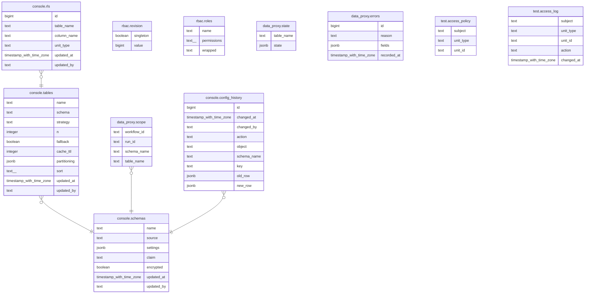
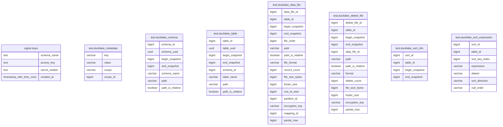
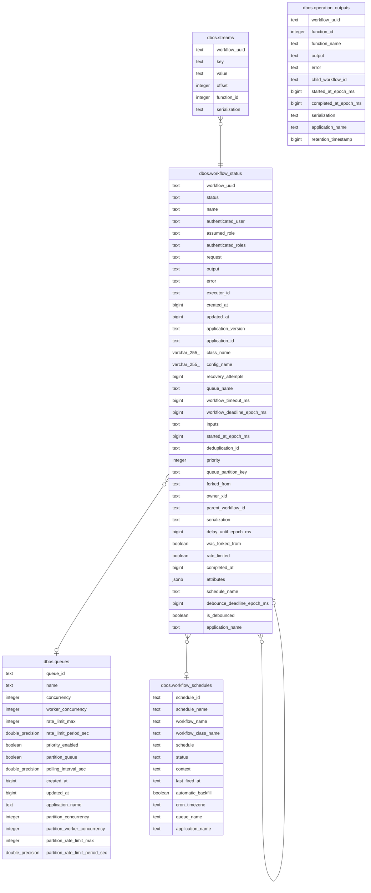

# Data model

This page shows the tables of the system. Each diagram has every column of its tables. A line joins a column to the column that it references. The crow's foot marks the table that has the reference.

A line is a foreign key, or a link that `docs/.tbls.yaml` adds where the database has no foreign key. The diagrams show no views and no functions. See [Database Schema](database.md) for those.

`docs:build:model` writes the diagrams from the database, and the files are in `docs/diagrams/`. Run it after a migration. See [Development](dev/index.md).

## All tables

This diagram joins the three diagrams below.

```mermaid
%% All database tables
erDiagram
"console.tables" }o--|| "console.schemas" : ""
"console.rls" }o--|| "console.tables" : ""
"data_proxy.scope" }o--|| "console.schemas" : ""
"console.config_history" }o--|| "console.schemas" : ""
"rbac.revision" {
  boolean singleton
  bigint value
}
"rbac.roles" {
  text name
  text__ permissions
  text wrapped
}
"data_proxy.state" {
  text table_name
  jsonb state
}
"data_proxy.errors" {
  bigint id
  text reason
  jsonb fields
  timestamp_with_time_zone recorded_at
}
"data_proxy.scope" {
  text workflow_id
  text run_id
  text schema_name
  text table_name
}
"console.schemas" {
  text name
  text source
  jsonb settings
  text claim
  boolean encrypted
  timestamp_with_time_zone updated_at
  text updated_by
}
"console.tables" {
  text name
  text schema
  text strategy
  integer n
  boolean fallback
  integer cache_ttl
  jsonb partitioning
  text__ sort
  timestamp_with_time_zone updated_at
  text updated_by
}
"console.rls" {
  bigint id
  text table_name
  text column_name
  text unit_type
  timestamp_with_time_zone updated_at
  text updated_by
}
"console.config_history" {
  bigint id
  timestamp_with_time_zone changed_at
  text changed_by
  text action
  text object
  text schema_name
  text key
  jsonb old_row
  jsonb new_row
}
"test.access_policy" {
  text subject
  text unit_type
  text unit_id
}
"test.access_log" {
  text subject
  text unit_type
  text unit_id
  text action
  timestamp_with_time_zone changed_at
}
"dbos.streams" }o--|| "dbos.workflow_status" : ""
"dbos.workflow_status" }o--o| "dbos.workflow_status" : ""
"dbos.workflow_status" }o--o| "dbos.queues" : ""
"dbos.workflow_status" }o--o| "dbos.workflow_schedules" : ""
"dbos.workflow_status" {
  text workflow_uuid
  text status
  text name
  text authenticated_user
  text assumed_role
  text authenticated_roles
  text request
  text output
  text error
  text executor_id
  bigint created_at
  bigint updated_at
  text application_version
  text application_id
  varchar_255_ class_name
  varchar_255_ config_name
  bigint recovery_attempts
  text queue_name
  bigint workflow_timeout_ms
  bigint workflow_deadline_epoch_ms
  text inputs
  bigint started_at_epoch_ms
  text deduplication_id
  integer priority
  text queue_partition_key
  text forked_from
  text owner_xid
  text parent_workflow_id
  text serialization
  bigint delay_until_epoch_ms
  boolean was_forked_from
  boolean rate_limited
  bigint completed_at
  jsonb attributes
  text schedule_name
  bigint debounce_deadline_epoch_ms
  boolean is_debounced
  text application_name
}
"dbos.operation_outputs" {
  text workflow_uuid
  integer function_id
  text function_name
  text output
  text error
  text child_workflow_id
  bigint started_at_epoch_ms
  bigint completed_at_epoch_ms
  text serialization
  text application_name
  bigint retention_timestamp
}
"dbos.streams" {
  text workflow_uuid
  text key
  text value
  integer offset
  integer function_id
  text serialization
}
"dbos.workflow_schedules" {
  text schedule_id
  text schedule_name
  text workflow_name
  text workflow_class_name
  text schedule
  text status
  text context
  text last_fired_at
  boolean automatic_backfill
  text cron_timezone
  text queue_name
  text application_name
}
"dbos.queues" {
  text queue_id
  text name
  integer concurrency
  integer worker_concurrency
  integer rate_limit_max
  double_precision rate_limit_period_sec
  boolean priority_enabled
  boolean partition_queue
  double_precision polling_interval_sec
  bigint created_at
  bigint updated_at
  text application_name
  integer partition_concurrency
  integer partition_worker_concurrency
  integer partition_rate_limit_max
  double_precision partition_rate_limit_period_sec
}
"signer.keys" {
  text schema_name
  text access_key
  text secret_sealed
  timestamp_with_time_zone created_at
}
"test.ducklake_metadata" {
  varchar key
  varchar value
  varchar scope
  bigint scope_id
}
"test.ducklake_schema" {
  bigint schema_id
  uuid schema_uuid
  bigint begin_snapshot
  bigint end_snapshot
  varchar schema_name
  varchar path
  boolean path_is_relative
}
"test.ducklake_table" {
  bigint table_id
  uuid table_uuid
  bigint begin_snapshot
  bigint end_snapshot
  bigint schema_id
  varchar table_name
  varchar path
  boolean path_is_relative
}
"test.ducklake_data_file" {
  bigint data_file_id
  bigint table_id
  bigint begin_snapshot
  bigint end_snapshot
  bigint file_order
  varchar path
  boolean path_is_relative
  varchar file_format
  bigint record_count
  bigint file_size_bytes
  bigint footer_size
  bigint row_id_start
  bigint partition_id
  varchar encryption_key
  bigint mapping_id
  bigint partial_max
}
"test.ducklake_delete_file" {
  bigint delete_file_id
  bigint table_id
  bigint begin_snapshot
  bigint end_snapshot
  bigint data_file_id
  varchar path
  boolean path_is_relative
  varchar format
  bigint delete_count
  bigint file_size_bytes
  bigint footer_size
  varchar encryption_key
  bigint partial_max
}
"test.ducklake_sort_info" {
  bigint sort_id
  bigint table_id
  bigint begin_snapshot
  bigint end_snapshot
}
"test.ducklake_sort_expression" {
  bigint sort_id
  bigint table_id
  bigint sort_key_index
  varchar expression
  varchar dialect
  varchar sort_direction
  varchar null_order
}
```

<!-- diagram:all-tables:start -->

<!-- diagram:all-tables:end -->

## Application database

The application database `data-proxy` has four groups of tables.

<!-- diagram:application:start -->

<!-- diagram:application:end -->

- **Configuration (`console`):** `schemas`, `tables` and `rls` store the sync configuration. A table belongs to one schema, and a row policy rule (`rls`) belongs to one table. The name of a schema can't be a reserved name. `config_history` records every change of these three tables. See [Configuration](console/configuration.md) and [Changes](console/changes.md).
- **Engine (`data_proxy`):** `state` has the state of each synced table as JSON. `errors` has the engine errors. `scope` links a workflow to the schemas and tables that a sync run covers. The console views use it to show a user only the sync runs of its own schemas.
- **Rules (`rbac`):** `roles` has the permissions of each role, filled from `rbac.toml`. `revision` is a single row with a counter. The proxy reads the counter to find a change of the rules.
- **Access policy (one schema for each source schema):** `access_policy` has the subjects that may read a unit, and `access_log` records each change. A trigger writes the log. See [Authorization](security/authorization.md).

The `data_proxy` and `console` tables don't reference each other with foreign keys. `scope.schema_name` and `config_history.schema_name` carry the name of a schema, and nothing enforces it.

## Catalog database

The `ducklake` database has two kinds of schema.

<!-- diagram:catalog:start -->

<!-- diagram:catalog:end -->

- **`signer.keys`:** one row for each schema. It has the storage access key of the schema and the sealed secret. The console reads it to sign file links. See [Query tab](console/query.md).
- **Metadata schemas:** DuckLake creates one schema for each source schema, with the name of the source schema. The diagram shows the tables that Data Proxy reads. [Other tables](#other-tables) lists the rest. The console reads `ducklake_table`, `ducklake_data_file` and `ducklake_delete_file` to list the files of a table. The sync service reads the sort tables to find the sort keys.

An empty `end_snapshot` marks a row that's still current. The code filters on it.

## Workflow tables

DBOS owns the `dbos` schema in the application database. The diagram shows the tables that the console reads. [Other tables](#other-tables) lists the rest.

<!-- diagram:workflow:start -->

<!-- diagram:workflow:end -->

- **`workflow_status`:** one row for each workflow. A sync run is a row with the name `run_sync`. Its tasks are rows with `parent_workflow_id` set to the id of the run.
- **`operation_outputs` and `streams`:** the steps and the log lines of a workflow.
- **`queues` and `workflow_schedules`:** the queues and the schedules. A workflow names its queue and its schedule.

The console views only read these tables. The console starts and controls a workflow with `dbos.enqueue_workflow()` and the `control` queue. See [Control a run and a schedule](console/runs.md). The column `data_proxy.scope.workflow_id` has the same value as `workflow_uuid`, so a view can filter the workflows by schema.

## Other tables

The diagrams leave out the tables that Data Proxy doesn't read directly. Every DuckLake metadata schema has the tables of the first group. The `dbos` schema has the tables of the second group.

<!-- tables:other:start -->
| Group             | Table                                   | Contents                                                              |
| ----------------- | --------------------------------------- | --------------------------------------------------------------------- |
| DBOS              | `application_versions`                  | The versions of the application that registered with DBOS.            |
| DBOS              | `dbos_migrations`                       | The DBOS migrations that ran.                                         |
| DBOS              | `event_dispatch_kv`                     | State that the DBOS event dispatchers keep between runs.              |
| DBOS              | `notifications`                         | Messages that a workflow sends to another workflow.                   |
| DBOS              | `workflow_events_history`               | Every value that a workflow set for an event.                         |
| DBOS              | `workflow_events`                       | The latest value of each event that a workflow sets.                  |
| DBOS              | `workflow_input`                        | The input of each workflow.                                           |
| DBOS              | `workflow_output`                       | The output of each workflow.                                          |
| DuckLake metadata | `ducklake_column_mapping`               | Links a file column to a table column when the file has no field IDs. |
| DuckLake metadata | `ducklake_column_tag`                   | The tags on a column.                                                 |
| DuckLake metadata | `ducklake_column`                       | The columns of each table, by snapshot.                               |
| DuckLake metadata | `ducklake_file_column_stats`            | The minimum and the maximum of each column in each data file.         |
| DuckLake metadata | `ducklake_file_partition_value`         | The partition value of each data file.                                |
| DuckLake metadata | `ducklake_file_variant_stats`           | The statistics of the parts of a variant column in each data file.    |
| DuckLake metadata | `ducklake_files_scheduled_for_deletion` | The files that a cleanup deletes later.                               |
| DuckLake metadata | `ducklake_inlined_data_tables`          | The tables that store rows inside the catalog.                        |
| DuckLake metadata | `ducklake_macro_impl`                   | The bodies of a macro.                                                |
| DuckLake metadata | `ducklake_macro_parameters`             | The parameters of a macro.                                            |
| DuckLake metadata | `ducklake_macro`                        | The SQL macros of the catalog.                                        |
| DuckLake metadata | `ducklake_name_mapping`                 | The column names that such a link uses.                               |
| DuckLake metadata | `ducklake_partition_column`             | The columns of a partition rule.                                      |
| DuckLake metadata | `ducklake_partition_info`               | The partition rules of a table.                                       |
| DuckLake metadata | `ducklake_schema_versions`              | The schema version of each snapshot.                                  |
| DuckLake metadata | `ducklake_snapshot_changes`             | The changes that each snapshot made.                                  |
| DuckLake metadata | `ducklake_snapshot`                     | One row for each snapshot of the catalog.                             |
| DuckLake metadata | `ducklake_table_column_stats`           | The statistics of each column over the whole table.                   |
| DuckLake metadata | `ducklake_table_stats`                  | The row count and the file size of each table.                        |
| DuckLake metadata | `ducklake_tag`                          | The tags on a catalog object.                                         |
| DuckLake metadata | `ducklake_view`                         | The views of the catalog.                                             |
<!-- tables:other:end -->

<!-- nav:start -->
---

[Previous: Database roles and grants](./grants.md) | [Next: Glossary](./glossary.md) | [Home](./index.md)
<!-- nav:end -->
