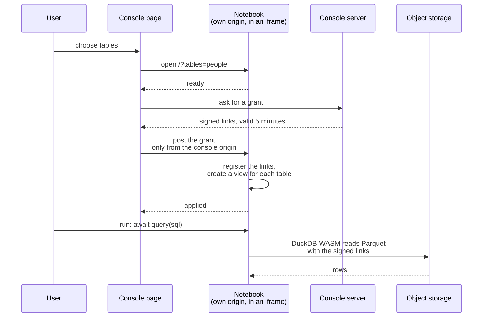

# Notebooks

The query tab of the console embeds a notebook that runs in the browser. `console/notebooks/` builds the static site of that notebook. The site runs on its own origin, so it shares no cookie with the console.



## What the site contains

The site is a static folder with no outside request. It has these parts:

- **A marimo notebook** (`notebooks/query.py`), exported with `marimo export html-wasm --offline`. Python runs in Pyodide. The notebook is in edit mode, so the user can write cells. The user presses Run once, and presses Ctrl+S before Export, Python, because marimo exports an empty file without the save. The file has the cells and no link, because a grant never enters the code. The page hides the SQL button of marimo. A SQL cell runs on the DuckDB of Pyodide, which can't see the signed links, so use `query` in a Python cell.
- **DuckDB-WASM**, with the Parquet extension on the same site. The policy of the site blocks the public repository, so the helper points `custom_extension_repository` to this site.
- **`src/helper.ts`**, in the Python worker. For each table it registers the signed links and creates a view. A data file with a delete file becomes an anti join on the row number, so a count matches the database. A new grant replaces the files, so an open notebook keeps working after the first links expire.
- **`src/bridge.ts`**, in the page. It accepts a grant only from the console that embeds the page, and it passes it to the worker. Both scripts check a grant with the valibot schema of `src/messages.ts`. They report `ready`, `applied`, `error` and a policy violation to the console.

The notebook follows the theme of the console. The console sends the message `theme` (`light` or `dark`) when the notebook is ready and each time the user switches the theme. The notebook starts in the light theme until the first message arrives.

## Query from a cell

The console opens the notebook with the tables that the user chose, as `/?tables=people&tables=orders`. The server repeats the template cell once for each table, and the name is the part of the table name after its last dot. The setup block defines one function, `query(sql, limit=100_000)`. It waits for the first grant, runs the SQL in DuckDB-WASM and returns at most `limit` rows as a Polars DataFrame. A scan of a large table stays in DuckDB-WASM, because the Python heap is the weak point of the page.

```python
await query('select * from "people" limit 15')
```

A cell needs `await`, because DuckDB-WASM runs in another worker. If the links expire, `query` tells the user to open the notebook again. If a table has no data files yet, it tells the user to sync the table. The Python package `duckdb` also runs in Pyodide, but it can't see the signed links and it doesn't apply the delete files, so use `query`.

## Build and serve

Run `nu console/notebooks/build.nu notebooks/query.py dist` to build the site. The header of `build.nu` lists the steps and the pins. The console image contains the site. The chart starts that image a second time with `node notebooks/server.ts`, as its own Deployment on its own host.

The server sends a Content Security Policy. The page can send data only to itself and to the storage host, and only the console can embed the page. `console/notebooks/csp.ts` builds the policy, and the chart builds the same string. The header of `server.ts` explains the policy and the cells.

<!-- nav:start -->
---

[Previous: Glossary](./glossary.md) | [Next: SQL Templates](./sql.md) | [Home](./index.md)
<!-- nav:end -->
