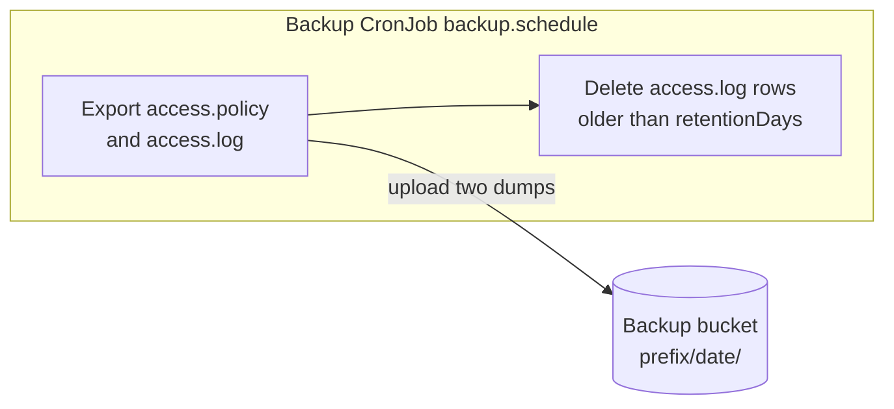

# Backups

A sync rebuilds application tables from the source. It doesn't rebuild access grants. The chart backs up the table `access.policy` and the audit trail `access.log`.

## Operation



Set `backup.enabled` to create the backup CronJob. The two tables store the grants of every project, so one run backs up all of them.

It exports `access.policy` and `access.log`, uploads both dumps to the separate backup S3/GCS-compatible service, then prunes `access.log` rows older than `backup.accessLog.retentionDays` with the procedure `access.prune_log`. The objects are:

```text
<backup.prefix>/<date>/policy.dump
<backup.prefix>/<date>/log.dump
```

The chart default prefix is:

```text
backups/access_policy
```

Backups contain only access-policy and audit-log data. They don't contain PostgreSQL tables, Parquet files or the full database.

## Configuration

```yaml
jobs:
  existingSecret: data-proxy-jobs
backup:
  enabled: true
  schedule: "0 3 * * *"
  prefix: backups/access_policy
  accessLog:
    retentionDays: 90
  s3:
    endpointURL: https://storage.googleapis.com
    bucket: access-policy-backups
```

The database Secret supplies the password of the `ops` role. The backup CronJob and the cleanup CronJob both connect as that role, like every other internal workload.

The default schedule is daily at 03:00 UTC. Configure bucket lifecycle rules for retention. The chart doesn't delete backup objects.

## Verify a backup

Download the dump and inspect it before restoring:

```bash
rclone copy \
  ":s3:<bucket>/backups/access_policy/<date>/policy.dump" \
  policy.dump

pg_restore --list policy.dump
```

## Restore

1. Download the reviewed dump from the separate backup service.
2. Restore it into a temporary database or table.
3. Compare it with `access.policy`.
4. Apply reviewed rows only.

Don't load an unreviewed backup into a live access policy table.

## Database backup

The whole database, with the DuckLake catalogs and the console data, has its own backup. Set `cnpg.backup.enabled` to turn it on. CloudNativePG (CNPG) then archives the write-ahead log (WAL) and takes a base backup each day, through the Barman Cloud plugin.

The plugin must run in the cluster before you turn the backup on, because the chart creates an `ObjectStore` that the plugin owns. The plugin has its own Helm chart, `plugin-barman-cloud`, in the namespace of the CNPG operator.

| Value | Contains |
| --- | --- |
| `cnpg.backup.bucket`, `cnpg.backup.destinationPath` | The bucket and the prefix of the backups. |
| `cnpg.backup.endpointURL` | The S3-compatible endpoint. For GCS, use `https://storage.googleapis.com`. |
| `cnpg.backup.existingSecret` | A Secret with `S3_ACCESS_KEY` and `S3_SECRET_KEY`. |
| `cnpg.backup.schedule` | The schedule of the base backups, with six fields. The first one is the seconds. |
| `cnpg.backup.retention` | The age after which the plugin deletes a backup and its WAL files. |

The chart takes the first base backup when it creates the schedule. `kubectl get backup` lists the backups, and `kubectl get cluster -o jsonpath='{.status.firstRecoverabilityPoint}'` shows the oldest point that you can restore.

The chart tells the AWS client to add checksums only when the storage requires them, because GCS refuses the default. A replica that falls behind catches up from the archive. The chart also limits what a replication slot keeps with `max_slot_wal_keep_size`, which is 8 GB by default. Without a limit, a slot that stops could fill the disk of the primary. Set a larger value in `cnpg.postgresql.parameters` for a larger disk.

## Turn the backup on in a running cluster

The plugin adds a sidecar to each instance pod, and CNPG restarts the primary in place, because a primary without the sidecar can't switch over. With two instances, the standby can't become ready while the primary is down. The cluster then stays in the phase `Primary instance is being restarted without a switchover`.

To end the wait, set `status.targetPrimary` of the Cluster to the standby, with the phase `Switchover in progress`. CNPG then starts the pods again. Recreate each instance pod once afterward, so that it reads a change in `instanceSidecarConfiguration`.

CNPG also refuses to change the image and a PostgreSQL parameter in one release when `primaryUpdateMethod` is `switchover`. Roll out a new parameter first with the image that runs now, and then roll out the new image.

## Restore the database

Restore the database with the recovery of the whole cluster. Create a new cluster with `bootstrap.recovery` that names the object store as its source. Check the new cluster before you point any workload at it, and keep the old cluster until the check ends.

## Upgrade PostgreSQL to a new major version

Don't change `cnpg.image` to a new major version in place. The image of `pg_duckdb` links `libduckdb.so` by an absolute path, so the CloudNativePG upgrade job can't start the old server. The job fails in seconds, and Helm rolls the release back.

Create a new cluster that imports the old one instead, with `bootstrap.initdb.import` of the type `monolith`. See the [CloudNativePG import guide](https://cloudnative-pg.io/documentation/current/database_import/). Stop the writers first, because the import copies one snapshot. Run a base backup before you start, and check the row counts of both clusters before you delete the old one.

<!-- nav:start -->
---

[Previous: Metrics](./metrics.md) | [Next: Terraform provider](../terraform.md) | [Index](./index.md) | [Home](../index.md)
<!-- nav:end -->
