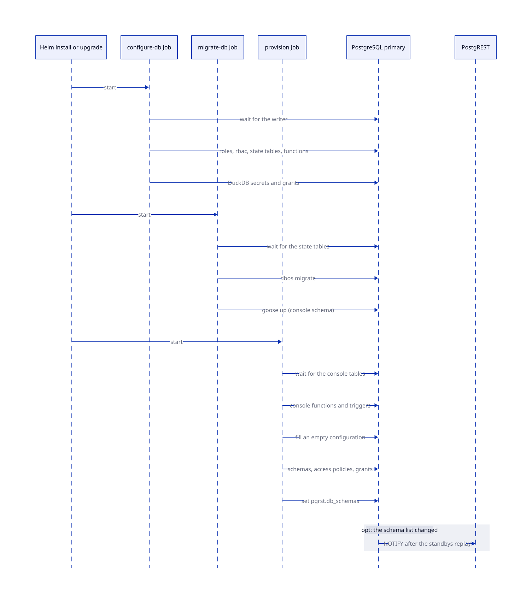

# Initialization

The chart sets up the database storage, runs the initialization Jobs, and waits until the database is ready.

## Database storage

CloudNativePG (CNPG) creates one retained PostgreSQL PersistentVolumeClaim (PVC) per instance. Configure the size under `cnpg.storage.size`. Kubernetes doesn't support PVC size reduction. Remove retained PVCs only as a separate destructive operation.

SeaweedFS stores Parquet data in its own configured storage. The PostgreSQL database uses pg_duckdb to read Parquet. pg_duckdb is an extension, not a separate database service.

## Database initialization and readiness

Three Jobs prepare the database, and each one waits for what it needs.



| Job | Waits for | Work |
| --- | --- | --- |
| `configure-db` | Its CNPG writer. | Runs idempotent SQL with `ON_ERROR_STOP=1`, as `ops`. CNPG owns two roles, `ops` and `duckdb`. The Job owns the system objects (see below). It also writes the persistent DuckDB secrets, which only a superuser may write. |
| `migrate-db` | The last of the state tables. | Runs in the sync image. It runs `dbos migrate` and `goose up`, and it owns the `console` schema of the console. The image contains `goose` and the files of `console/migrations`. |
| `provision` | The `console` tables. | Runs on every install and upgrade. See below. |

The system objects of `configure-db` are:

- the request roles: `anon`, the `dp_*` roles of `rbac.toml`, and the `serving` login
- the `rbac` schema
- the state, error and scope tables of the engine
- the pre-request function and its grants
- the functions that reload PostgREST
- the maintenance procedures

`provision` also exists as a suspended CronJob, `<release>-provision`, that a Job comes from when a schema changes (see [Run a Job on demand](initialization.md#run-a-job-on-demand)). On install and upgrade, it does these steps:

- It first installs the functions and triggers of the console, which need the tables and views of the migrations.
- It fills an empty configuration once from `sync.config`. Afterward the console controls the configuration.
- It grants the baseline role (`auth.userRole`, which every `dp_*` role is a member of) its rights on the `console` schema. The rights are wide, and each view, row policy, and function asks for the permission of the token.
- For each schema in `console.schemas`, it creates the PostgreSQL schema and its access policy, with row policies that ask for `read_policy` and `edit_policy`.
- It grants the anonymous role the right to call `console.config()`, the one function that the proxy reads.
- It sets `pgrst.db_schemas` on the `serving` login to the schemas plus `console`, in that order, because the first schema is the default profile of PostgREST.
- It tells PostgREST to reload only when that list changes. The database waits until every standby replayed the change, then sends a `NOTIFY` on the `pgrst` channel.

PostgREST serves a schema that an editor adds within seconds. The job drops a schema that an editor removes: the files first, then the catalog, then the schema of the database. See [Console](../console/configuration.md#add-and-remove-a-schema).

[Development](../development/migrations.md) explains what belongs to the chart and what belongs to the migrations.

## Run a Job on demand

`configure-db` and `provision` each exist twice. One is a Job named by the release revision, which Helm runs on every install and upgrade. The other is a suspended CronJob, `<release>-configure-db` and `<release>-provision`.

A suspended CronJob never runs on a clock. It contains the pod definition, and both objects get it from one helper, so they can't differ. Something that needs the work creates a Job from the CronJob:

| Context | Who creates the Job | What runs |
| --- | --- | --- |
| Install and upgrade | Helm | The per-revision Jobs, with every schema (`PROVISION_ALL=true`). |
| An editor adds or removes a schema in the console | The sync worker. A trigger on `console.schemas` queues the workflow `provision_schemas`. | `provision`: what's pending and what's removed. |
| The start of every sync run | The sync worker, with the same call | `provision`. A lost event or a drift heals here. |
| An operator, after a change of `rbac.toml` or a failed run | A person | `configure-db` or `provision`. |

The one-line command for a person:

```bash
kubectl -n data-proxy create job --from=cronjob/<release>-provision provision-by-hand
kubectl -n data-proxy create job --from=cronjob/<release>-configure-db configure-db-by-hand
```

The sync ServiceAccount may read the CronJobs and create Jobs in its namespace, and nothing more.

The PostgREST Deployment uses an HTTP readiness probe on `/`. It isn't Ready until PostgREST is serving its configured schema.

<!-- nav:start -->
---

[Previous: Helm Chart](helm.md) | [Next: Ingress](ingress.md) | [Index](index.md) | [Home](../index.md)
<!-- nav:end -->
