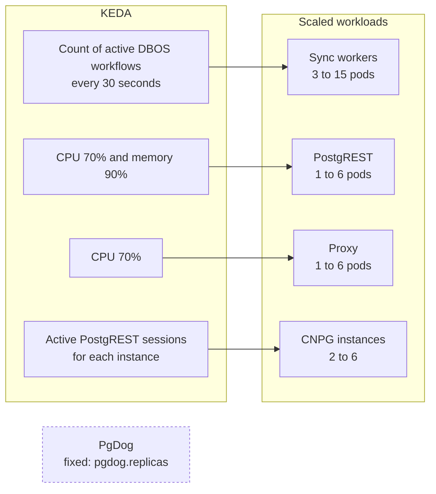

# KEDA Scaling

Kubernetes Event-driven Autoscaling (KEDA) scales the DBOS sync Deployment from the DBOS system database. The sync workers share the `data-proxy-duckdb` PersistentVolumeClaim (PVC). They publish through one `publish` queue that's partitioned by schema, so each schema runs one publish task at a time.



KEDA also scales PostgREST, the proxy and the CloudNativePG (CNPG) standbys. [Topology](topology.md) describes how.

```yaml
triggers:
  - type: postgresql
    metadata:
      connectionFromEnv: DBOS_SYSTEM_DATABASE_URL
      query: "SELECT ceil(COUNT(*)::decimal / 16) FROM dbos.workflow_status WHERE application_name = 'data-proxy-sync' AND status IN ('PENDING', 'ENQUEUED', 'DELAYED', 'RUNNING');
      targetQueryValue: "1.1"
      activationTargetQueryValue: "5"
```

`connectionFromEnv` reads `DBOS_SYSTEM_DATABASE_URL`. The query counts pending, queued, delayed and running DBOS workflows for the sync application.

## Orchestrator and dump workers

These Helm values set the scale and the concurrency of the sync workers. The table gives the default of each value.

| Value | Helm default | Meaning |
| --- | --- | --- |
| `sync.autoscaling.minReplicaCount` | `3` | Minimum active sync replicas. |
| `sync.autoscaling.maxReplicaCount` | `15` | Maximum sync replicas. |
| `sync.autoscaling.pollingInterval` | `30` | Seconds between KEDA checks. |
| `sync.autoscaling.cooldownPeriod` | `60` | Seconds before scale-down. |
| `sync.autoscaling.targetQueryValue` | `"1.1"` | Target query value. |
| `sync.autoscaling.activationTargetQueryValue` | `"5"` | Activation threshold. |
| `sync.dumpQueueWorkerConcurrency` | `2` | Dump concurrency per sync process. |
| `ducklake.secrets.storage` | see values | Shared volume of the DuckDB secrets. |
| `sync.dumpStepMaxAttempts` | `3` | Dump workflow retry attempts. |

## Dump concurrency

A worker takes small batches: two dumps at a time. KEDA adds pods when more dumps wait. Each dump and each publish opens a DuckDB connection, so the concurrency sets how much memory a pod needs. For the memory and spill values, see [DuckDB memory and spill](helm.md#duckdb-memory-and-spill).

The queue stores its limits when it starts for the first time, and a restart keeps them. A change of `sync.dumpQueueWorkerConcurrency` therefore changes only a new installation. To change an installed queue, update the row in the system database. The workers read the row again within seconds, so they need no restart.

```sql
UPDATE dbos.queues SET worker_concurrency = 2 WHERE name = 'dump';
```

## Catalogs

The DBOS sync workers write the catalogs in the `ducklake` database, through the primary. PostgreSQL replication copies them to every standby.

Publishing remains parallel across schemas because each schema has a separate metadata schema in the catalog database. Publishing remains sequential within one schema because its DBOS queue has global concurrency one.

## Configuration

This example shows the Helm values that set the schedule, the retries and the KEDA scaling of the sync workers.

```yaml
sync:
  schedule: "0 2 * * *"
  dumpStepMaxAttempts: 3
  dumpQueueWorkerConcurrency: 2
  # DBOS workers use the shared data-proxy-duckdb PVC.
  autoscaling:
    minReplicaCount: 3
    maxReplicaCount: 15
    pollingInterval: 30
    cooldownPeriod: 60
    targetQueryValue: "1.1"
    activationTargetQueryValue: "5"
```

DBOS deduplicates the scheduled workflow across orchestrator replicas. The sync Deployment never scales below `minReplicaCount`, so a new schedule always reaches a worker. The chart doesn't set `idleReplicaCount`, because KEDA supports only `0` for it and any other value makes KEDA and the HPA fight.

---

<!-- nav:start -->
---

[Previous: Console variables](./console.md) | [Next: Metrics](./metrics.md) | [Index](./index.md) | [Home](../index.md)
<!-- nav:end -->
