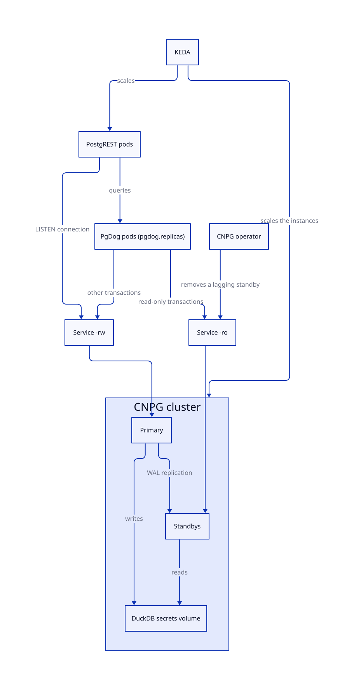

# Topology

The chart always deploys the same pieces:

| Part       | Role                                                                                                                             |
| ---------- | -------------------------------------------------------------------------------------------------------------------------------- |
| PostgreSQL | One CloudNativePG (CNPG) Cluster with a primary and at least one standby. `cnpg.autoscaling` adds standbys under load. CNPG promotes a standby on failure. |
| PgDog      | A pooler in front of PostgreSQL. It sends read-only transactions to the standbys and every other transaction to the primary. It runs `pgdog.replicas` pods (two by default), and no scaler. |
| PostgREST  | One Deployment that connects to PgDog. `postgrest.autoscaling` scales it.                                                        |
| Proxy      | Sends every request to PostgREST.                                                                                                |



PostgREST starts a read-only transaction for each `GET`, and a read/write transaction for each write and each function call. PgDog reads that option from the `BEGIN`. A `GET` goes to a standby, and a write goes to the primary. With one instance, or while no standby can serve, PgDog reads from the primary.

PgDog pools transactions, so many PostgREST connections share a few PostgreSQL backends. The pool uses the `serving` login. The chart renders it into the `<release>-pgdog-users` Secret.

PgDog finds the standbys through the `-ro` Service of the cluster, so it sees them as one host. Kubernetes picks the standby for each new connection. PgDog closes a server connection after about five minutes, so a new standby takes its share within that time. In a measured run the standbys served 50% and 50% of the reads, and in one of four runs 31% and 69%.

The lag of a standby works like this:

- CNPG takes a standby that's more than `cnpg.maxReplicaLag` behind out of the `-ro` Service until it catches up.
- After a change of the pod, CNPG updates the standbys first and then moves the primary to a standby by a switchover (`cnpg.primaryUpdateMethod`). A restart of the primary leaves every standby unready, because their readiness probe needs a streaming connection, and the update then waits.
- A standby that stops answering leaves the Service within about six seconds.
- PgDog doesn't measure the lag. Its time-based lag limit counts an idle primary as lag.
- A pool that can't connect gets no requests for 10 seconds, and the next read goes to the primary.

The PostgREST connection address lists PgDog first and the `-rw` Service second. PostgREST asks for a read/write session for its `LISTEN` connection. PgDog never gives one, so the listener connects to the primary. A `NOTIFY` on the primary then reaches PostgREST.

A read that follows a write can reach a standby that hasn't replayed the write. The lag stays below `cnpg.maxReplicaLag`, and normally it's a few milliseconds. A caller that needs the new row immediately reads it from the answer of the write (`Prefer: return=representation`).

Only the primary database keeps state. A scaled-down standby loses its volume. The primary keeps its data.

Kubernetes Event-driven Autoscaling (KEDA) sets the count of every workload except PgDog. Helm sets only `pgdog.replicas`, because each extra PgDog pod opens its own pools and adds connections to PostgreSQL. Helm never sets `replicas` or `instances` on any other workload, so an upgrade can't conflict with a scaler.

Default scaling:

| Workload | Default trigger | Minimum | Maximum | Wait before scale-down |
| --- | --- | --- | --- | --- |
| Cluster (CNPG instances) | Active PostgREST sessions per instance. The target comes from the CPU limit and the DuckDB threads. | 2 | 6 | 300 s |
| PostgREST | CPU and memory. | 1 | 6 | 300 s |
| Proxy | CPU and memory. | 1 | 3 | 300 s |
| Sync workers | The count of active DBOS workflows. See [KEDA Scaling](keda.md). | 3 | 15 | 60 s |
| PgDog | None. Helm sets `pgdog.replicas`. | 2 | 2 | Not applicable |
| Redis | None, unless you supply custom triggers. | Not applicable | Not applicable | Not applicable |

Set `triggers` in an `autoscaling` block to replace a default. KEDA can't scale a CNPG resource on CPU, because the resource has no pod selector.

Notes for the cluster:

- Every instance has the same `cnpg.resources`.
- The chart raises the instance floor to 2 (one primary and one standby). Raise it more with `cnpg.autoscaling.minReplicaCount`.
- Replication is asynchronous, so a changed access policy can reach a standby a moment later. To make `access_policy` writes wait until a standby applies them, set `cnpg.postgresql.synchronous` (for example `{method: any, number: 1, dataDurability: preferred}`) after the cluster has scaled up. CNPG rejects it on one instance, so it can't be a default. A trigger then raises `synchronous_commit` to `remote_apply` for access policy writes only, and other commits use `local`.
- The DuckDB secrets (the S3 secret `s3`, and the catalog secrets `ducklake_catalog_pg` and `ducklake_catalog`) are files in `/duckdb/secrets` on the shared `<release>-duckdb` volume. The chart creates the volume when `ducklake.secrets.storage.storageClass` is set. Set it before you serve data, because the console adds schemas after the install and the chart can't know them. Every instance mounts that folder at `~/.duckdb/stored_secrets`, and only the primary writes it. The catalogs aren't on this volume: they live in the `ducklake` database, and every standby gets its own copy through replication. After the first upgrade that adds a secret, run `helm upgrade` once more so `configure-db` writes it to the volume.
- DuckDB reads the S3 secret once for each PostgreSQL backend. When the S3 keys change, `helm upgrade` rolls PgDog and the PostgREST pods, so every backend reloads the secret. Run `helm upgrade` a second time if a read happens between the roll and the `init-db` write.

```yaml
redis:
  existingSecret: data-proxy-redis
  host: redis-writer
  port: 6379
```

`host` and `port` are the one stable Redis endpoint the proxy uses. `host` has no default, and the chart fails to render without it. The operator provides it, with replication and failover behind it. The Redis Secret contains a JSON value under `REDIS` for the sync workers:

```json
{"read":"redis://reader:6379/1","write":"redis://writer:6379/0"}
```

Redis has no autoscaler unless you supply custom triggers.

<!-- nav:start -->
---

[Previous: Ingress](ingress.md) | [Next: Environment Variables](environment.md) | [Index](index.md) | [Home](../index.md)
<!-- nav:end -->
