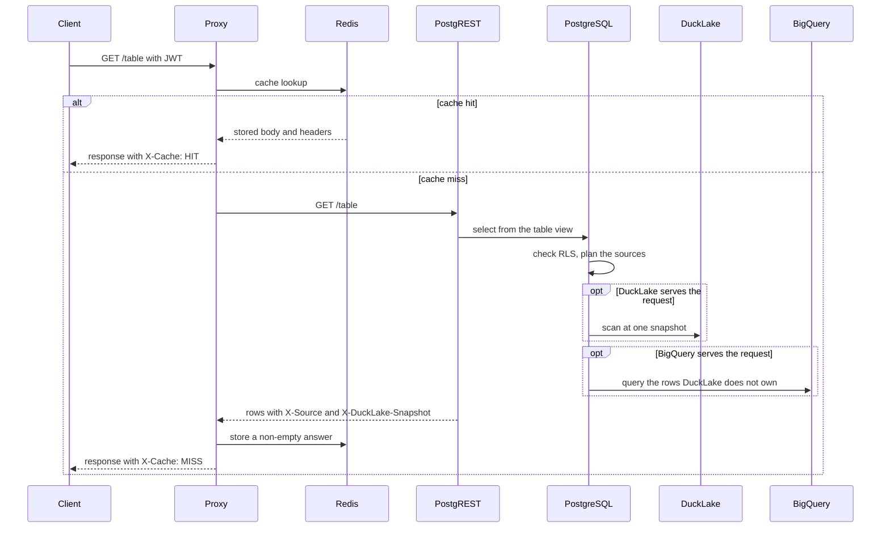

# Proxy

The proxy sits in front of PostgREST. It forwards requests and caches read responses. It doesn't choose where data comes from: PostgreSQL decides that for every request.

The chart deploys the proxy as OpenResty and connects directly to Redis. Configure it under `proxy` in [Helm Chart](helm_chart.md#proxy).

## Request flow

## Choosing the source

The table view calls one function that applies these rules in order:

1. A request that pins a snapshot is read from DuckLake only.
2. A partitioned table that's not in `data_proxy.state` reads its configured source when `fallback` is true. Without fallback, the request gets a `404`.
3. A table in `data_proxy.state` reads DuckLake. A partitioned table with `fallback: true` also reads uncovered partitions from its configured source.

Row-level security runs first. A request that RLS stops reads no source and gets an empty list without `X-Source`.

An empty DuckLake result never triggers fallback. With `fallback: true`, every request also reads the configured source for partitions that DuckLake doesn't hold, because PostgREST applies filters after the function returns. Keep fallback disabled when that cost isn't acceptable.

## Filter pushdown

The proxy forwards only the `where` part of a query to PostgreSQL, in the `X-DuckLake-Filter` header, so the table view can filter rows before it reads the sources. Everything else stays with PostgREST: `order`, `limit`, `offset`, `select`, embeds, and content negotiation.

The parser reads the query parameters that hold comparisons, and the `and`, `or` and `not` groups, and decodes the escapes in their keys and values. A parameter that its grammar doesn't accept is skipped, and PostgREST then applies the whole query. The grammar is LPeg, in `proxy/src/proxy/parser/patterns.lua`. The document the parser builds is checked with the `filter_document` schema before it goes out, so a filter that the PostgreSQL side can't render fails in the proxy with the field named.

## Cache

- Only non-empty `GET` answers with status 200 are stored. An empty answer can mean that access was denied, that data isn't published yet, or that a policy changed, so it's never stored.
- The key includes the method, path, query, schema profile, representation headers, pinned snapshot version, and identity claims. Different identities don't share entries.
- An entry stores the body with `X-Source` and `X-DuckLake-Snapshot`, so a cache hit reports what produced the answer. `X-Cache` tells a hit from a miss.
- OpenResty doesn't cache ranged, write, oversized, or non-JSON responses. `/access_policy` and its subpaths are never cached.
- Cache reads use the Redis reader endpoint. Cache writes use the Redis writer endpoint. Webdis isn't part of the request path.
- The sync flushes the cache after each run.
- A successful write to `/access_policy` through the proxy raises the policy generation, a counter in Redis. Every key includes it, so answers from before the change are never served again. A change made directly in the database doesn't raise it. Those answers stay until their lifetime ends or the next sync flushes the cache.

See [Using the API](using.md#response-source-and-cache) for the response headers.

## Settings

The Helm Deployment sets the proxy settings as `PROXY_*` environment variables. See [Environment Variables](environment_variables.md#openresty-proxy) for each variable, its default, and its meaning. `helm/files/nginx.conf` lists every variable with an `env` directive, because nginx removes the other variables. Lua code reads settings only through the table that `config.load` returns. `main` loads it once at start-up, in `init_by_lua`, and passes it down. The load collects the text of every variable in one table, and converts and checks the table once with the `config` schema. The schema also gives the defaults. A missing required variable, a value of the wrong type, or a value outside the limits stops nginx from starting, with an error that names the setting. The variable is `PROXY_` and the upper-case name of the setting. `sync.json` sets only the cache time of each table and the paths that are never cached, and the proxy checks it with a schema when it starts. The proxy checks the other data that it doesn't create in the same way: the entries that it reads from Redis, and the claims of a bearer token. The `Schema` class is in `proxy/src/proxy/schemas/schema.lua`, and the registry is `proxy/src/proxy/schemas/main.lua` (`schemas:register(name, fields)`). When the registry module loads at start-up, it registers every file `proxy/src/proxy/schemas/definitions/<name>.lua` as the schema `<name>`. A definition file gives only the fields. Code checks data with `schemas.<name>:validate(value)`.

---

[← Previous](security.md) · [Home](../README.md) · [Next →](keda.md)
