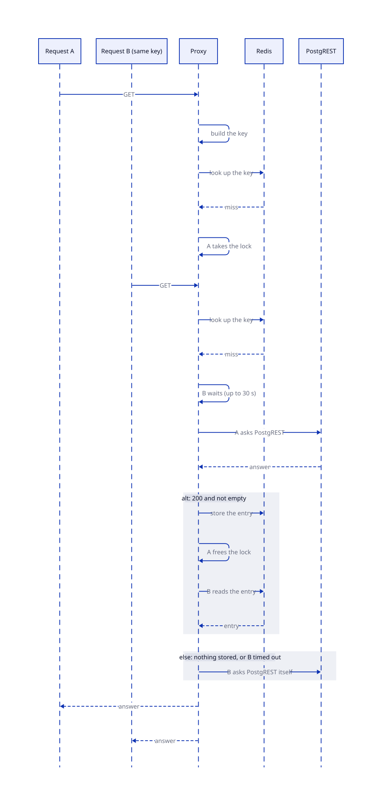

# Cache

- The proxy stores only non-empty `GET` answers with status 200. An empty answer can mean three things: access was denied, the data isn't published yet, or the access policy changed. The proxy never stores it.
- An entry stores the body with `X-Source` and `X-DuckLake-Snapshot`, so a cache hit reports what produced the answer. `X-Cache` tells a hit from a miss.
- OpenResty doesn't cache ranged, write, oversized, or non-JSON responses. `/access_policy` and its subpaths are never cached.
- Cache reads use the Redis reader endpoint. Cache writes use the Redis writer endpoint.
- The sync service flushes the cache after each sync run.
- The key has the parts in the table below, and the table also has the two counters that keep the cache current.
- When an entry is missing, only one request for that key asks PostgREST. The lock section shows how.

## The cache key

| Key part | Why it's in the key |
| --- | --- |
| Method, path and query | They name the request. |
| Schema profile and representation headers | The same path can answer in another schema or format. |
| The pinned snapshot (`X-DuckLake-Snapshot`) | A pinned read must not share an entry with the latest data. |
| The scope of the user, or the user, then the schemas and the role | A token with another identity never reads an answer that another token cached. Users with the same grants have the same scope and share their answers. |
| The access policy generation | A write to `/access_policy` through the proxy raises this counter in Redis. |
| The settings revision | `console.config()` contains it in its document. Any other change of the access policy or the rules moves `rbac.revision`. |

A trigger on `rbac.revision` queues a `reload_proxy` workflow. The sync worker asks every proxy pod to read the settings. A proxy that takes a new document stops serving the old answers immediately. Examples of such a change are a write to the access policy from the console, and a new `rbac.toml` that `configure-db` loads.

## The scope

The document of `console.config()` lists a scope for each subject of the access policies. The scope is the MD5 digest of the grants of the subject in every schema: the schema, the unit type and the unit id, sorted. Two subjects with the same grants have the same scope, so the proxy puts `scope:<digest>` in the key and they share the answers. A subject that the document doesn't list gets `sub:<user>`, so the key is its own. A user name that looks like a digest never reads the entries of a scope, because of the prefixes.

The document has no scopes if a schema reads its rows by another claim than `preferred_username`, because the proxy names a subject by that claim. A change of one grant moves `rbac.revision`, so the next document has new scopes and every answer has a new key. The document grows with the number of subjects, about 60 bytes for each, and the shared dictionary `proxy_settings` has 4 MB for it.

The revision comes from the document, not from Redis. A flush of the cache, a restart of the proxy, and a new proxy pod all leave it right. The proxy finds a change that happened while no proxy ran when it reads the document.

## The lock

Without a lock, a slow entry that expires sends every request for it to PostgREST at the same time. A table that reads the source is an example. The requests fill the connections of PostgREST and the limit of `proxy.maxInflight`, and the proxy then answers 503 for every route.

The proxy calls the first request for a key the leader. The other requests for the same key are followers, and they wait for the leader.

- A follower waits up to 30 seconds and reads the entry that the leader stored.
- The lock is `resty.lock`, which OpenResty ships, in the shared dictionary `proxy_locks`. A leader that dies frees the key after 60 seconds.
- The wait is per proxy pod. A request that waits doesn't count against `proxy.maxInflight`.
- A follower asks PostgREST itself if the leader stored nothing (for example after an error) or if the wait times out.

See [Using the API](../using.md#response-source-and-cache) for the response headers.

<!-- nav:start -->
---

[Previous: Query pushdown](pushdown.md) | [Next: Retries and limits](limits.md) | [Index](index.md) | [Home](../index.md)
<!-- nav:end -->
