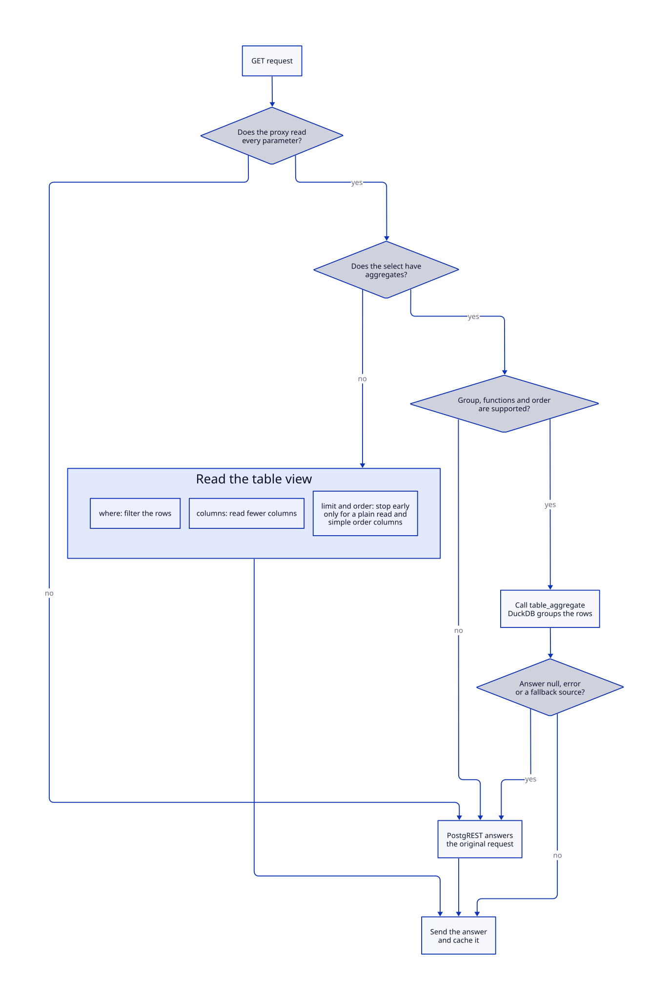

# Query pushdown

The proxy forwards what it reads from a query to PostgreSQL, in the `X-DuckLake-Filter` header. The table view can then read less data from the sources.

| Part | What the table view does with it |
| --- | --- |
| `where` | Filters the rows before it reads the sources. |
| `columns` | Reads only the selected columns, the order columns, and the filter columns. The other columns come back as null. |
| `limit` and `order` | Stops after the first rows. The limit includes the `offset`. |

PostgREST still applies `select`, `order`, `limit`, `offset`, embeds, and content negotiation to the rows that the table view returns. A pushed part only makes that set smaller, so the answer stays the same.

The proxy sends `columns` and `limit` only when it reads every parameter of the query. A parameter that it can't read, such as a filter that its grammar doesn't accept, stops both. A `select` with an alias, a cast, or an embed stops them too. A `select` with aggregates sends `columns` and never `limit`, as the next section shows. The proxy also drops `limit` for a request that needs every row:

- A request with `Prefer: count=...` or a `Range` header.
- A request for a single object or another media type of PostgREST.
- A `HEAD` request.

The table view pushes `order` with the limit only when every order column is a whole number, a date, or a true or false value. DuckDB sorts text by bytes, and PostgreSQL sorts it by the collation, so a limit on a text order could return other rows. Columns of other types reach PostgreSQL as text, and the same rule applies to them.

A request that selects all columns of a wide table still reads all of them. A `count` of a table or a request without `limit` reads every row too.

## Aggregates

A `select` with aggregates, for example `select=grp,numerador:qty.sum(),total:count()`, runs inside DuckDB. The proxy puts the group and the aggregates in the `aggregate` field of the header. Then it calls the function `<table>_aggregate()` of the table, as `GET /rpc/<table>_aggregate`, with the same headers and no query string. The function applies the RLS and the filter, runs the `GROUP BY` in DuckDB, and returns the result rows as JSON. PostgreSQL then receives one row for each group and not one row for each row of the table.

| Part of the select | Supported |
| --- | --- |
| Plain columns, with or without an alias (`alias:column`) | They form the group. The columns must be text, whole-number, date, or true-or-false columns, so the value in the answer has the same type as in the table. |
| `sum()` and `avg()` of a column | A numeric column in DuckDB, which includes decimal and floating point columns. PostgreSQL receives those as text and can't sum them, so the table path fails with `function avg(text) does not exist`. |
| `min()` and `max()` of a column | A numeric column or a date column. |
| `count()` and `column.count()` | Any column that doesn't contain JSON. |
| `order` | Columns of the group, by the name of the column, with `asc`, `desc`, `nullsfirst` and `nullslast`. |
| `limit` and `offset` | Yes. They apply to the rows of the groups, after the order. |

The proxy sends the original request to PostgREST, and nothing changes for the client, in these cases:

- The `order` names an aggregate, an alias or a column outside the group. The group has a decimal, floating point, timestamp or JSON column, so DuckDB would give another type than the table.
- The select has another function than `sum`, `avg`, `count`, `min` and `max`, a cast, an embed, a star, or two values with the same name. The request has `Prefer: count=...` or a `Range` header, asks for another media type than JSON, is a `HEAD`, or isn't a read.
- The function answers `null` (a fallback source serves a part of the table, or the aggregate uses an unsupported column type), doesn't exist, or fails.

DuckDB runs the filter and the `GROUP BY`. PostgreSQL then orders and cuts the rows of the groups, so the text order follows the collation of the database, as in the table.

The function gives at most `postgrest.maxRows` rows, as PostgREST does. If the answer has more rows, the function gives the first rows with the status `206` and `Content-Range: <first>-<last>/*`. A request with a `limit` below the cap gets exactly that many rows and no `206`. The proxy sends the `206` unchanged and doesn't store it.

The function passes the grants of the subject to DuckDB as one list for each column, `IN (SELECT unnest([...]))`. In staging this form ran about four times faster than an `IN` list of 2,000 literals.

Without an `order`, DuckDB stops after the rows that the answer needs. For an aggregate, the proxy never sends `order` or `limit` at the top of the filter. The table function would cut the rows before the aggregation.

The answer of the function has no `Content-Range` header. It has the same `X-Source` and `X-DuckLake-Snapshot` headers as the table, and the cache stores it under the key of the original request.

The parser reads comparisons and the `and`, `or` and `not` groups, and it decodes the escapes. The grammar is LPeg, in `proxy/src/proxy/parser/patterns.lua`. The proxy checks the document with the `filter_document` schema before it sends it. A document that PostgreSQL can't render fails in the proxy with the field named.

<!-- nav:start -->
---

[Previous: Proxy](index.md) | [Next: Cache](cache.md) | [Index](index.md) | [Home](../index.md)
<!-- nav:end -->
