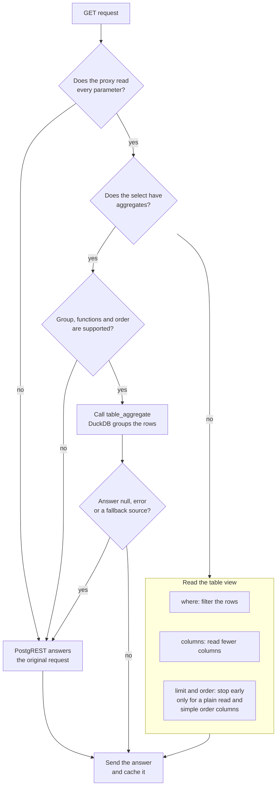

# Query pushdown

The proxy forwards what it reads from a query to PostgreSQL, in the `X-DuckLake-Filter` header. The table view can then read less data from the sources. The parser reads comparisons and the `and`, `or` and `not` groups, and it decodes the escapes. The grammar is LPeg, in `proxy/src/proxy/parser/patterns.lua`.

| Part                | What the table view does with it                                                                                 |
| ------------------- | ---------------------------------------------------------------------------------------------------------------- |
| `where`             | Filters the rows before it reads the sources.                                                                    |
| `columns`           | Reads only the selected columns, the order columns, and the filter columns. The other columns come back as null. |
| `limit` and `order` | Stops after the first rows. The limit includes the `offset`.                                                     |

PostgREST still applies `select`, `order`, `limit`, `offset`, embeds and content negotiation to the rows that the table view returns. A pushed part only makes that set smaller, so the answer stays the same.

The proxy sends `columns` and `limit` only when it reads every parameter of the query. A parameter that it can't read, such as a filter that its grammar doesn't accept, stops both. A `select` with an alias, a cast or an embed stops them too. A `select` with aggregates sends `columns` and never `limit`, as the next section shows. The proxy also drops `limit` for a request that needs every row:

- A request with `Prefer: count=...` or a `Range` header. The [counts](#counts) section shows the exception.
- A request for a single object or another media type of PostgREST.
- A `HEAD` request.

The table view pushes `order` with the limit only when every order column is a whole number, a date or a true or false value. DuckDB sorts text by bytes, and PostgreSQL sorts it by the collation, so a limit on a text order could return other rows. Columns of other types reach PostgreSQL as text, and the same rule applies to them.

A request that selects all columns of a wide table still reads all of them.

## Aggregates

A `select` with aggregates, for example `select=grp,numerador:qty.sum(),total:count()`, runs in DuckDB.

1. The proxy puts the group and the aggregates in the `aggregate` field of `X-DuckLake-Filter`.
2. It calls `GET /rpc/<table>_aggregate` with the same headers and no query string.
3. The function applies the row policy and the filter, runs the `GROUP BY` in DuckDB and returns the result rows as JSON.
4. PostgreSQL orders and cuts the rows of the groups.

| Part of the select                                       | Supported                                                                                          |
| -------------------------------------------------------- | -------------------------------------------------------------------------------------------------- |
| Plain columns, with or without an alias (`alias:column`) | They form the group. Text, whole-number, date and true-or-false columns only.                      |
| `sum()` and `avg()` of a column                          | A numeric column, which includes decimal and floating point columns.                               |
| `min()` and `max()` of a column                          | A numeric column or a date column.                                                                 |
| `count()` and `column.count()`                           | Any column that doesn't contain JSON.                                                              |
| `order`                                                  | Columns of the group, by the name of the column, with `asc`, `desc`, `nullsfirst` and `nullslast`. |
| `limit` and `offset`                                     | Yes. They apply to the rows of the groups, after the order.                                        |

The proxy sends the original request to PostgREST in these cases:

- The `order` names an aggregate, an alias or a column outside the group.
- The group has a decimal, floating point, timestamp or JSON column.
- The select has a function other than `sum`, `avg`, `count`, `min` and `max`, a cast, an embed, a star or two values with one name.
- The request has `Prefer: count=...` or a `Range` header, asks for another media type than JSON, is a `HEAD` or isn't a read.
- The function answers `null`, doesn't exist or fails. It answers `null` when a fallback source serves a part of the table. It also answers `null` for an unsupported column type.

The proxy never sends `order` or `limit` in the filter of an aggregate.

The function gives at most `postgrest.maxRows` rows. With more rows it gives the first rows with the status `206` and `Content-Range: <first>-<last>/*`. A request with a `limit` below the cap gets exactly that many rows and no `206`. The proxy sends the `206` unchanged and doesn't store it.

A complete answer has no `Content-Range` header. It has the same `X-Source` and `X-DuckLake-Snapshot` headers as the table, and the cache stores it under the key of the original request.

## Counts

A `GET` of a table with `Prefer: count=exact` and a `limit` counts in DuckDB. The proxy calls `<table>_aggregate` with the filter and `count()`. Then it reads the page with the `limit`, pinned to the snapshot of the count. It builds `Content-Range` and `Preference-Applied`, and sends `206` unless the page has every row. Other counts, `Range`, `HEAD`, an empty page and a table with a fallback source go to PostgREST, which counts every row.

<!-- nav:start -->
---

[Previous: Proxy](./index.md) | [Next: Cache](./cache.md) | [Index](./index.md) | [Home](../index.md)
<!-- nav:end -->
