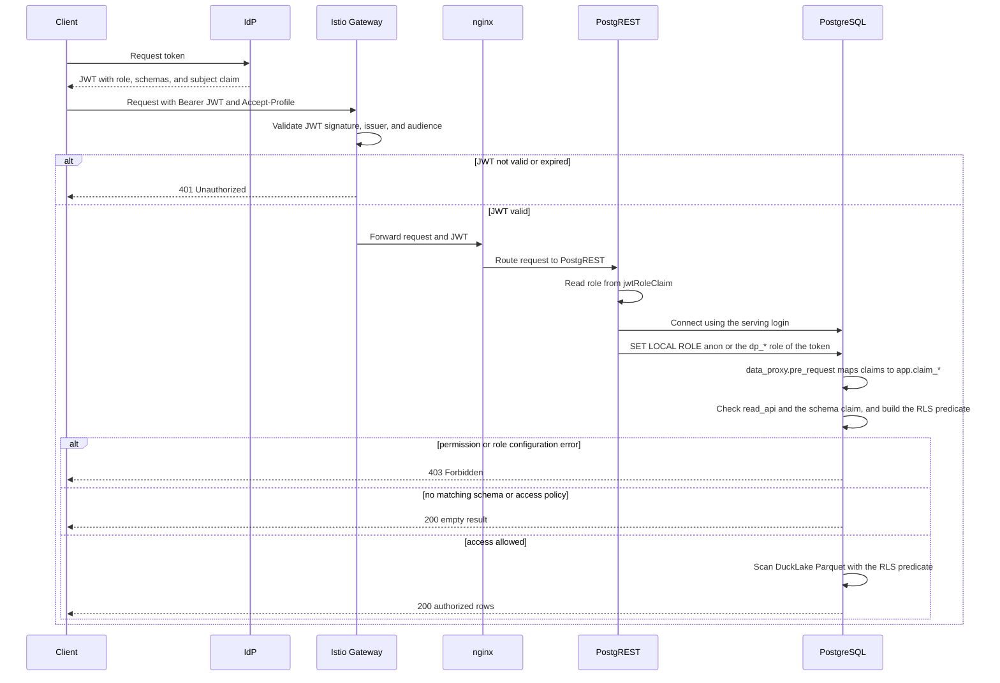
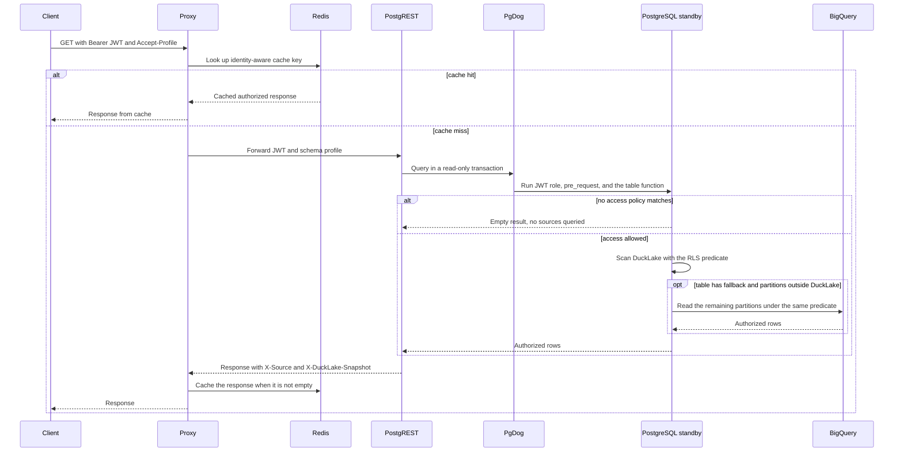

# Security

Data Proxy enforces access in PostgreSQL. The table function passes the RLS predicate into DuckDB, so the Parquet scan reads only authorized rows. PostgREST query filters, such as `?id=eq.1`, are applied in PostgreSQL after DuckDB returns the authorized rows. Data Proxy doesn't calculate business permissions in nginx or in the client.

## Configure the access model

The following values must agree:

```yaml
auth:
  anonRole: anon
  userRole: dp_api
  servingRole: serving
  jwtRoleClaim: $.role

sync:
  config:
    schemas:
      test:
        claim: preferred_username
        tables:
          - name: project.dataset.participants
            strategy: full
            rls:
              - column: region_id
                unit_type: region
```

These settings mean:

- PostgREST reads the PostgreSQL role from the JWT `role` claim.
- `schemas` must contain `test`.
- The JWT `preferred_username` value is matched with `access_policy.subject`.
- Rows are visible only when the unit columns match enabled policy rows.

## Required JWT claims

A normal end-user token for the example above contains claims similar to:

```json
{
  "role": "dp_api",
  "schemas": ["test"],
  "preferred_username": "test_user_1"
}
```

The `role` claim is one role of `rbac.toml`, and PostgREST switches to the database role of the same name. The role decides what the token may do. A token without `read_api` can't read any synced view. The [permissions](#permissions) section lists all of them.

The exact identity claim is configured per schema. If the schema uses `sub` instead of `preferred_username`, the policy subject must match the token's `sub` value.

## Permissions

A token carries one `role` claim, and the rules of that role live in `helm/files/config/rbac.toml`. The file lists the permissions, grouped by object, and the roles (`dp_api`, `dp_policy`, `dp_console` and `dp_admin`) with the roles that each one inherits. The `configure-db` job loads the file into the `rbac` schema, and `rbac.can('<permission>')` answers whether the role of the request holds a permission. `rbac.mine('<schema>')` answers whether a schema is in the `schemas` claim. A permission name that the file doesn't list raises an error, so a typo in the code fails loudly. Three permissions belong to the data API and its access policy:

| Permission | What it opens |
| --- | --- |
| `read_api` | The synced views. The row policy still limits the rows. |
| `read_policy` | Read `<schema>.access_policy` for the schemas in the `schemas` claim. |
| `create_policy`, `edit_policy`, `delete_policy` | Insert, update, and delete in `<schema>.access_policy` for the schemas in the claim. |

Give a role `read_policy` together with `edit_policy`, because an update reads the row first. The other permissions open the console and the catalog. `delete_config` is a destructive permission: a deleted schema loses its data, its catalog and its files ([Console](console.md#add-and-remove-a-schema)).

The proxy puts the role in the cache key, so a token with another role never gets an answer that another token cached.

The JWT role and RLS flow is:



CNPG manages two roles: `ops` (the owner and a superuser) and `duckdb` (the read-only catalog login). The `configure-db` job creates the rest as `ops`:

| Role                     | Purpose                                                                        |
| ------------------------ | ------------------------------------------------------------------------------ |
| `anon`                   | Role of a request without a token, with no application table access.           |
| `dp_api`, `dp_policy`, `dp_console`, `dp_admin` | One role for each role of `rbac.toml`. A token switches to the role of its `role` claim, and the rules decide what that role may do. The schema and row policies limit the rows. |
| `serving`                | The login of the serving path: PostgREST, the PgDog pool and the recovery Deployment (`auth.servingRole`). It's `NOINHERIT` and can switch to `anon` and to every `dp_*` role. |

[Database](database.md#roles) describes each role and why `ops` is a superuser.

Init-db creates the `data_proxy` schema and its internal functions, procedures, and grants. `data_proxy` isn't in `PGRST_DB_SCHEMAS`, so these objects aren't exposed as RPC endpoints. `data_proxy.pre_request()` copies JWT claims into transaction-local PostgreSQL settings. `USAGE` on `data_proxy` doesn't grant application table access.

## Schema and row authorization

Authorization has two independent conditions.

### Schema condition

The token must list the requested schema:

```json
"schemas": ["test"]
```

The client must select the same schema:

```http
Accept-Profile: test
```

### Row condition

For a table with this configuration:

```json
"rls": [
  {"column": "region_id", "unit_type": "region"}
]
```

an active policy row must match the user's subject and the row's unit:

```text
subject   = JWT preferred_username (or configured claim)
OR unit_type/unit_id matches the row
```

A policy row exists only while the grant is active. Revoking access deletes the row. A missing schema claim or policy grant normally returns `200 []`. It isn't an authentication error.

## Seed access policy

Create one confidential client for the service that manages the policy, and give its token the role `dp_policy` for the schemas that it manages. Its token looks like this:

```json
{
  "role": "dp_policy",
  "schemas": ["test"],
  "preferred_username": "test_policy"
}
```

The token reads and writes `<schema>.access_policy` for the schemas in its claim. `dp_policy` holds only the four policy permissions: `read_policy`, `create_policy`, `edit_policy`, and `delete_policy`. Deleting a row revokes the grant; the change is recorded in `test.access_log`.

### Set up the role claim in an identity provider

The token needs one `role` claim with the name of a role of `rbac.toml`. In Keycloak, create the roles `dp_api`, `dp_policy`, `dp_console`, and `dp_admin` as client roles of one client, give each user or service account one of them, and add a *User Client Role* mapper to the client scope with these settings:

| Setting | Value |
| --- | --- |
| Client ID | The client that owns the roles. |
| Token claim name | `role` |
| Several values | Off |
| Add to access token | On |

Add a second mapper for the `schemas` claim (a user attribute with several values) and a third for `preferred_username`. Another identity provider needs the same three claims. A user who needs two roles takes a role that inherits both in `rbac.toml`, because a token carries one. The `k3d` test realm has one client, `idp`, that's set up like this recipe: the client roles `dp_api` and `dp_console`, a *User Client Role* mapper for `role`, a *User Attribute* mapper with several values for `schemas`, and the users `idp_viewer` and `idp_console` that log in with a password. The `idp` scenario of the end-to-end suite reads their tokens and uses them on the data API and on the console. The other test clients carry a fixed `role` claim.

Use that token and the target schema profile:

```bash
curl --request POST \
  --header "Authorization: Bearer ${POLICY_WRITER_TOKEN}" \
  --header "Content-Type: application/json" \
  --header "Accept-Profile: test" \
  --header "Prefer: resolution=merge-duplicates" \
  --data '[
    {"subject": "test_user_1", "unit_type": "region", "unit_id": "region_1"}
  ]' \
  "${BASE_URL}/access_policy"
```

The policy subject must equal the configured identity claim in the end-user JWT.

### Use another identity provider

The gateway, PostgREST and the proxy need the same three claims from any provider that issues JWTs and publishes a JWKS. Set these values, and then give each client the claims:

| Value | What it sets |
| --- | --- |
| `ingress.auth.issuer`, `ingress.auth.jwksUri`, `ingress.auth.audience` | The gateway accepts only tokens of this issuer and audience. |
| `postgrest.jwksUri` | PostgREST validates the signature with these keys. |
| `auth.jwtRoleClaim` | The claim that holds the role. The default is `$.role`. |

| Claim | Value | How to add it |
| --- | --- | --- |
| `role` | One role of `rbac.toml`, as text. | Keycloak: a mapper that sets a fixed claim on a service client, or a *User Client Role* mapper for users. Auth0: an Action that sets a custom claim. `Entra ID`: an app role, with a claims mapping policy that renames it. |
| `schemas` | A list of schema names, or one name as text. | A user attribute with several values, or a fixed list on a service client. An empty list reads nothing. |
| `preferred_username` | The subject of the access policy. | The default claim of most providers. If yours doesn't set it, the policy subject must be the `sub` value. |

The token must also carry the audience that the gateway expects. Then check it before you deploy:

1. Get a token: `nu scripts/token.nu --issuer https://sso.example.com/realms/prod --client-id <client> --client-secret <secret>`.
2. Decode the payload and check that `role`, `schemas` and `preferred_username` are there, and that `aud` and `iss` match the values above.
3. Call `/<table>?limit=1` with the token. A token with an unknown role gets 400 or 403, and a token without a role reads nothing.

A claim that names a role that isn't in `rbac.toml` never gains rights: PostgREST can switch only to the roles that the serving login is a member of, and `verify-rbac` makes sure that this list is the list of the file.

### Check the roles at deploy time

Two checks keep `rbac.toml` and the database in step:

- `lint:toml` runs in the checks of the repository. `taplo` checks `rbac.toml` against `rbac.schema.json`: each object has a description and at least one action, and each role has a name.
- The `configure-db` Job runs `verify-rbac` after it loads the rules, and fails when the database differs from the file: a role is missing, a request role can log in or is a superuser, the serving login isn't a member of a role, or is a member of a role that the file doesn't list. A role that left the file thus can't keep its rights without a failed upgrade.

A permission that the SQL asks for and the file lacks ends as an HTTP 500 at run time. The `roles` scenario of the end-to-end suite checks this.

### Token lifetime

A token is valid until it expires. If you disable a user or change a role in the identity provider, the token that the user already holds keeps its rights until it expires. The next token has the new role. The cache key includes the role, so a token with another role never reads an answer that was cached for the old one.

Set the access token lifetime to **5 minutes**. This is the default of Keycloak, and the `k3d` realm sets it in `accessTokenLifespan`. In Keycloak, open *Realm settings*, *Tokens*, and set *Access Token Lifespan*. A client can override it under *Clients*, *Advanced*, *Advanced settings*. Other providers have the same setting under another name.

### Revoke access

Delete the grant:

```bash
curl --request DELETE \
  --header "Authorization: Bearer ${POLICY_WRITER_TOKEN}" \
  --header "Accept-Profile: test" \
  "${BASE_URL}/access_policy?subject=eq.test_user_1&unit_type=eq.region&unit_id=eq.region_1"
```

The row is removed from `test.access_policy` and its previous state is written to `test.access_log` with `action = 'delete'`. To grant access again, insert the row again. No resync or token refresh is required. Every change of a policy row makes the cached answers stale, whether it passed the proxy or not: a trigger on the revision counter queues a reload of the proxy ([Proxy](proxy.md#cache)).

## Query tab scope

The query tab hands out signed links to Parquet files. Three layers scope the links to one schema:

| Layer | What it checks | What it stops |
| --- | --- | --- |
| Application database | `read_files`, the schema in the `schemas` claim, that the table exists, and that the schema isn't encrypted. It verifies the token. | A user who asks for a schema outside the claim. |
| Catalog role | The role `schema_<name>` reads the metadata of its schema only. | The console server that lists the files of another schema by mistake. |
| Signed links | A link works for one object and one signature. A credential limited to the prefix of a schema can't sign a key outside it. | A path that isn't in the list, a changed key, and a link for another file. |

The layers protect against a partial bug, such as a wrong table name or a path that a user supplies. They don't protect against a stolen console server. The server holds the catalog login and the signing credentials, and neither the catalog nor the storage sees the token of the user. Only the application database verifies the token, so the server must call `table_files` first and use the schema that it authorizes for the other two layers. A row policy keyed on a session setting isn't a layer, because the session can change the setting.

Row-level security doesn't apply to the files, so a user with `read_files` reads every row of the tables of their schemas. Only `dp_admin` holds `read_files`.

With `console.storage.perSchemaIdentities`, the console makes one storage identity for each schema, with a policy that allows `s3:GetObject` on the folder of that schema only. Nothing lists the schemas: the first query of a schema makes its identity. The price is that the console holds an admin credential of the storage, so a stolen console can change the identities. When a schema leaves the console, the sync worker deletes its identity. A storage that can't limit a credential to a prefix, such as GCS, signs with one read-only credential. Then the first two layers are the only scope.

Every link is a `GET`. A `HEAD` request on a link signed for `GET` answers 403, and so does a changed signature. The notebook origin is a different site from the console, so the notebook can't read the cookie of the console.

## Read requests

Use a normal end-user token:

```bash
curl \
  --header "Authorization: Bearer ${USER_TOKEN}" \
  --header "Accept-Profile: test" \
  "${BASE_URL}/participants?limit=20"
```

The proxy sends every request to PostgREST, and PgDog sends a `GET` to a standby. BigQuery rows follow the same authentication and RLS rules as DuckLake rows:



See [Proxy](proxy.md) for the routing and cache rules. `/access_policy` is never response-cached.

## Expected results

| Result          | Meaning                                                                   |
| --------------- | ------------------------------------------------------------------------- |
| `200` with rows | Token, schema, role, grants, and RLS checks passed.                       |
| `200 []`        | The request is valid, but the schema claim or row policy exposes no rows. |
| `401`           | The JWT is missing, not valid, expired, or can't be used by PostgREST.    |
| `403`           | PostgreSQL/PostgREST permission or role configuration isn't valid.        |
| `404`           | The schema profile, the table, or the snapshot is unknown or unpublished. |

## Troubleshooting

| Symptom                                       | Check                                                                                                   |
| --------------------------------------------- | ------------------------------------------------------------------------------------------------------- |
| `401 Unauthorized`                            | Check the JWT signature, issuer, audience, expiry, and `role` claim.                                    |
| `403` with `permission denied to set role`    | Check that `configure-db` completed: the `auth.servingRole` login must be a member of `anon` and of every `dp_*` role. |
| `403` with `permission denied for schema data_proxy` | Check `GRANT USAGE ON SCHEMA data_proxy TO anon/user`.                                             |
| `200 []` for every table                      | Check `schemas`, the schema profile, the configured subject claim, and enabled `access_policy` rows.    |
| `404 Unknown schema profile`                  | Check `Accept-Profile`, and check that the provision job ran for the schema.                                                       |
| Policy write fails                            | Check that the token has `edit_policy` and `read_policy`, that its `schemas` claim names the schema, and that `Accept-Profile` matches. |
| Results differ between requests               | Check `X-Source`, `X-DuckLake-Snapshot`, and `X-Cache`; every source uses the same JWT and RLS rules. |
| `/access_policy` appears cached               | It must never be cached. Check nginx configuration and response headers.                                |

See [Using the API](using.md), [Database Schema](database.md), and [Proxy](proxy.md) for related details.

---

[← Previous](using.md) · [Home](../README.md) · [Next →](proxy.md)
