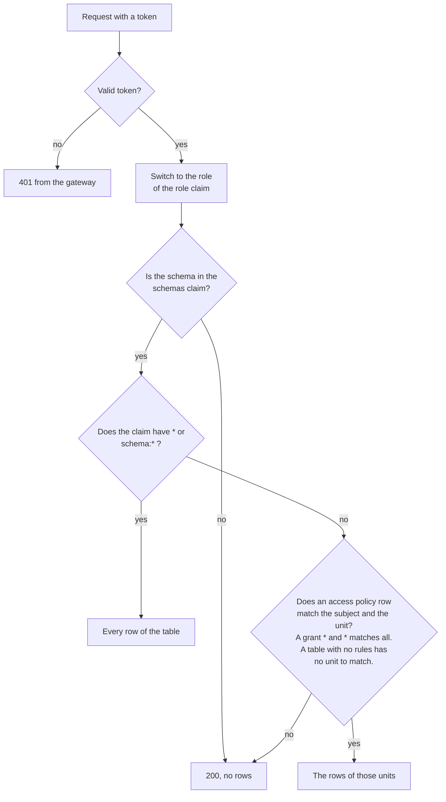

# Schema and row authorization

Authorization has two independent conditions. The diagram shows the order of the checks.



## Schema condition

The token must list the requested schema:

```json
"schemas": ["test"]
```

The client must select the same schema:

```http
Accept-Profile: test
```

The schema name `*` stands for every schema. Use it only for a debugging account in staging. The token then reads and changes every schema, and it also reads every row, as the next section describes.

```json
"schemas": ["*"]
```

The element `<schema>:*` reaches one schema and reads every row of it. A token with it needs no access policy row for that schema, and it reaches no other schema.

```json
"schemas": ["test:*"]
```

## Row condition

For a table with this configuration:

```json
"rls": [
  {"column": "region_id", "unit_type": "region"}
]
```

an active access policy row must match the user's subject and the row's unit:

```text
subject   = JWT preferred_username (or configured claim)
OR unit_type/unit_id matches the row
```

A token whose `schemas` claim has `*`, or `<schema>:*` for the schema of the table, skips this condition and reads every row.

A subject with the grant `unit_type = '*'` and `unit_id = '*'` in the `access_policy` of the schema reads every row of the tables of that schema too. The grant covers one subject and one schema. Revoking it deletes the row, like any other grant.

### A list column

The column of an `rls` rule can hold a list of text, such as `area_responsavel` with the type `ARRAY<STRING>` in BigQuery. A row is visible when at least one value of the list equals a unit of the grant. A row with an empty list or a NULL list is visible only to a reader of every row. A list of another type stops the sync with an error.

### Groups of rules

Rules are alternatives by default. A reader sees a row when any one rule matches a grant. Give rules the same `group` to make them all necessary:

```json
"rls": [
  {"column": "region_id", "unit_type": "region", "group": 1},
  {"column": "unit_id", "unit_type": "unit", "group": 1},
  {"column": "area", "unit_type": "area"}
]
```

A reader sees a row when its `region_id` and its `unit_id` match grants, or when its `area` matches a grant.

A group needs a grant for each of its rules. A reader who lacks one grant gets no row from that group. A missing grant never widens the filter.

### A table with no rules

The default is to deny. A table with no `rls` rules has no unit column to match, so it returns no row to a token that lists the schema. Only two cases read it: a token with `*` or `<schema>:*`, and a subject with the grant `*` and `*`. To give a user the rows, grant `*` and `*`, or add `rls` rules to the table and grant its units.

The same rule applies to the table function, the aggregate function and the change feed of the table.

An access policy row exists only while the grant is active. Revoking access deletes the row. A missing schema claim or access policy grant normally returns `200 []`. It isn't an authentication error.

## Seed access policy

Create one confidential client for the service that manages the access policy, and give its token the role `dp_policy` for the schemas that it manages. Its token looks like this:

```json
{
  "role": "dp_policy",
  "schemas": ["test"],
  "preferred_username": "test_policy"
}
```

The token reads and writes `<schema>.access_policy` for the schemas in its claim. `dp_policy` has only the four policy permissions: `read_policy`, `create_policy`, `edit_policy` and `delete_policy`. Deleting a row revokes the grant. The database records the change in `test.access_log`.

<!-- nav:start -->
---

[Previous: Authorization flow](./flow.md) | [Next: Requests](./requests.md) | [Index](./index.md) | [Home](../index.md)
<!-- nav:end -->
