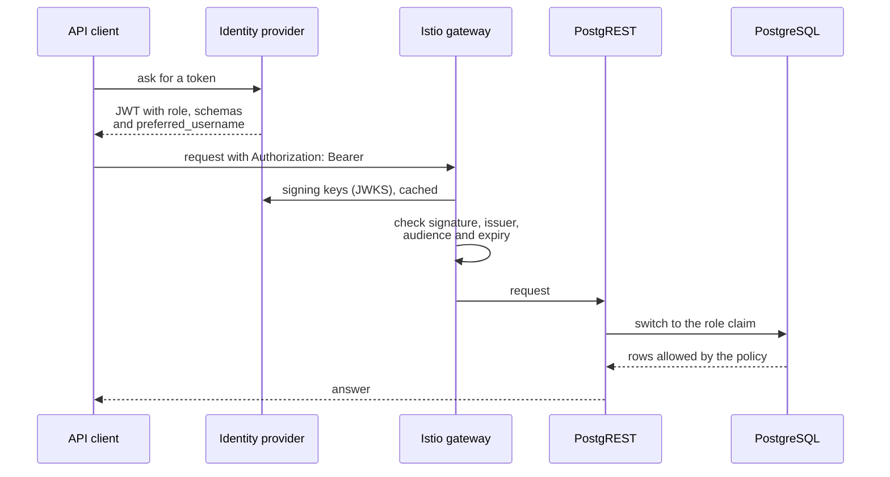

# Identity provider

This page shows how to set up the `role` and `schemas` claims in your identity provider. It also says what another provider needs, and how to check the roles when you deploy.

The diagram shows what happens to a token on its way to the data.



## Set up the role claim in an identity provider

The token needs one `role` claim with the name of a role of `rbac.toml`.

In Keycloak, do these steps:

1. Create the roles `dp_api`, `dp_policy`, `dp_console`, and `dp_admin` as client roles of one client.
2. Give each user or service account one of them.
3. Add a *User Client Role* mapper to the client scope. The next table gives its settings.

| Setting | Value |
| --- | --- |
| Client ID | The client that defines the roles. |
| Token claim name | `role` |
| Several values | Off |
| Add to access token | On |

Add a second mapper for the `schemas` claim (a user attribute with several values) and a third for `preferred_username`. Another identity provider needs the same three claims.

A user who needs two roles takes a role that inherits both in `rbac.toml`, because a token has one.

An older Keycloak writes the single client role as the text `[dp_admin]`, even when *Multivalued* is off. PostgREST then finds no role. In that case replace the mapper with a *User Attribute* mapper: the user attribute `role`, the claim name `role`, and the type String. Then give each user the attribute `role` with the name of one role. `nu scripts/kc.nu check` reports this case.

The `k3d` test realm has one client, `idp`, that's set up like this recipe:

- the client roles `dp_api` and `dp_console`
- a *User Client Role* mapper for `role`
- a *User Attribute* mapper with several values for `schemas`
- the users `idp_viewer` and `idp_console` that log in with a password

The `idp` scenario of the end-to-end suite reads their tokens and uses them on the data API and on the console. The other test clients carry a fixed `role` claim.

Use that token and the target schema profile:

```bash
curl --request POST \
  --header "Authorization: Bearer ${POLICY_WRITER_TOKEN}" \
  --header "Content-Type: application/json" \
  --header "Accept-Profile: test" \
  --header "Prefer: resolution=merge-duplicates" \
  --data '[
    {"subject": "test_user_1", "unit_type": "region", "unit_id": "region_1"}
  ]' \
  "${BASE_URL}/access_policy"
```

The access policy subject must equal the configured identity claim in the end-user JSON Web Token (JWT).

## Create the console client

`scripts/kc.nu` prints the document for the Keycloak partial import and checks a token. The header of the script has the steps. Print the document with `nu scripts/kc.nu client --host <host> > console-client.json`, import it in the realm, and check a token with `nu scripts/kc.nu check <access_token> --issuer <issuer>`.

## Use another identity provider

The gateway, PostgREST and the proxy need the same three claims from any provider that issues JWTs and publishes a JWKS. Set these values, and then give each client the claims:

| Value | What it sets |
| --- | --- |
| `ingress.auth.issuer`, `ingress.auth.jwksUri`, `ingress.auth.audience` | The gateway accepts only tokens of this issuer and audience. |
| `postgrest.jwksUri` | PostgREST validates the signature with these keys. |
| `auth.jwtRoleClaim` | The claim that contains the role. The default is `$.role`. |

| Claim | Value | How to add it |
| --- | --- | --- |
| `role` | One role of `rbac.toml`, as text. | Keycloak: a mapper that sets a fixed claim on a service client, or a *User Client Role* mapper for users. Auth0: an Action that sets a custom claim. `Entra ID`: an app role, with a claims mapping policy that renames it. |
| `schemas` | A list of schema names, or one name as text. | A user attribute with several values, or a fixed list on a service client. An empty list reads nothing. The name `*` stands for every schema and every row. Give it only to a debugging account. The element `<schema>:*` names one schema and reads every row of it. |
| `preferred_username` | The subject of the access policy. | The default claim of most providers. If yours doesn't set it, the access policy subject must be the `sub` value. |

The token must also carry the audience that the gateway expects. Get a token with `nu scripts/token.nu --issuer <issuer> --client-id <client> --client-secret <secret>`, and decode its payload. Check that `role`, `schemas` and `preferred_username` are there, and that `aud` and `iss` match your values. Then call `/<table>?limit=1`. A token with an unknown role gets 400 or 403, and a token without a role reads nothing.

A claim that names a role that isn't in `rbac.toml` never gains rights. PostgREST can switch only to the roles that the serving login is a member of. `verify-rbac` makes sure that this list is the list of the file.

## Check the roles at deploy time

Two checks keep `rbac.toml` and the database in step. `chart:lint:toml` checks `rbac.toml` against `rbac.schema.json`: each object has a description and an action, and each role has a name. The `configure-db` Job runs `verify-rbac` after it loads the rules. It fails in three cases. A role is missing. A request role can log in or is a superuser. The serving login belongs to a role that the file doesn't list. A role that left the file can't keep its rights without a failed upgrade.

A permission that the SQL asks for and the file lacks ends as an HTTP 500 at run time. The `roles` scenario of the end-to-end suite checks this.

<!-- nav:start -->
---

[Previous: Requests](requests.md) | [Next: Tokens](tokens.md) | [Index](index.md) | [Home](../index.md)
<!-- nav:end -->
