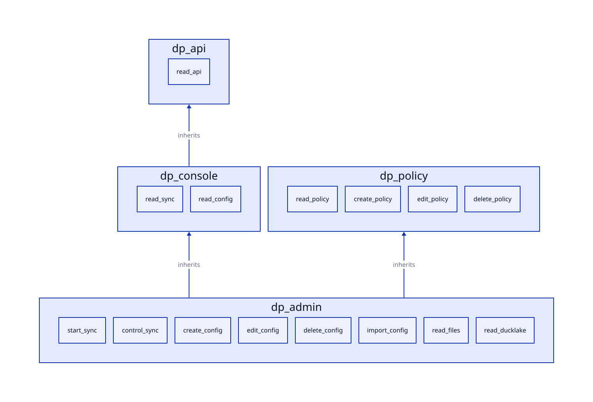

# Roles

`rbac.toml` defines four roles, and each inherits the permissions of the roles that it lists. The identity provider and the database use the same names. A token has one role.

The table shows the permissions that each role has, with the inherited ones. The task `docs:build:roles` writes it from `rbac.toml`.

<!-- roles-matrix:start -->
| Permission      | `dp_api` | `dp_policy` | `dp_console` | `dp_admin` |
| --------------- | -------- | ----------- | ------------ | ---------- |
| `read_api`      | yes      |             | yes          | yes        |
| `read_ducklake` |          |             |              | yes        |
| `read_files`    |          |             |              | yes        |
| `read_sync`     |          |             | yes          | yes        |
| `start_sync`    |          |             |              | yes        |
| `control_sync`  |          |             |              | yes        |
| `read_config`   |          |             | yes          | yes        |
| `create_config` |          |             |              | yes        |
| `edit_config`   |          |             |              | yes        |
| `delete_config` |          |             |              | yes        |
| `import_config` |          |             |              | yes        |
| `read_policy`   |          | yes         |              | yes        |
| `create_policy` |          | yes         |              | yes        |
| `edit_policy`   |          | yes         |              | yes        |
| `delete_policy` |          | yes         |              | yes        |
<!-- roles-matrix:end -->

| Role | Inherits | Adds |
| --- | --- | --- |
| `dp_api` | | `read_api` |
| `dp_policy` | | `read_policy`, `create_policy`, `edit_policy`, `delete_policy` |
| `dp_console` | `dp_api` | `read_sync`, `read_config` |
| `dp_admin` | `dp_console`, `dp_policy` | `start_sync`, `control_sync`, `create_config`, `edit_config`, `delete_config`, `import_config`, `read_files`, `read_ducklake` |

`dp_policy` is for an API that registers its own access policies. `dp_admin` runs schemas, and every role is limited to the schemas in its claim. A user has one role. A person who needs both console and access policy rights takes `dp_admin`.

## How the rules are tested

The Python tests in `sync/tests/unit/test_templates.py` run the `create_rbac` template on the real test server with the real `rbac.toml`.

They compare `rbac.can()` for every role and permission with a reference that the test computes itself. Hypothesis tests do the same for random rules files and random names. The end-to-end suite in `k6/scenarios/` tests the console with real tokens (`console.js` and `roles.js`) on the k3d cluster. It doesn't run in CI, because it needs the cluster. Run it before you merge a change to a permission, a role, an access policy, a view, or the console schema (`devenv shell -- nu scripts/cluster.nu k6 e2e`).

<!-- nav:start -->
---

[Previous: Permissions](permissions.md) | [Next: Authorization flow](flow.md) | [Index](index.md) | [Home](../index.md)
<!-- nav:end -->
