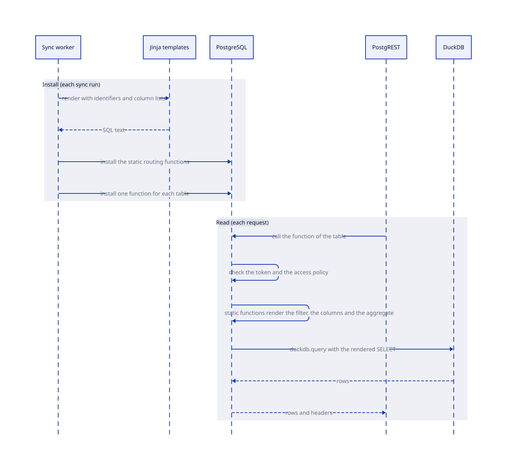

# SQL Templates

SQL templates live under `sync/src/sync/templates/<target>/`. Each target is one database backend. Helm maintenance templates live under `helm/files/templates/postgres/`.

## How a request becomes SQL

SQL has three layers. Each layer has one job.

| Layer | Written in | Runs | Does |
| ----- | ---------- | ---- | ---- |
| Template | Jinja | At each sync run | Fills the identifiers and the column lists of the function of one table. |
| Static function | PL/pgSQL | At each request | Reads the filter and builds the text of the DuckDB query. It doesn't depend on a table. |
| Dynamic SQL | `format()` | At each request | Runs the text that a static function built, with `%I` and `%L`. |



Put logic in a static function and not in a template. A static function has one name, one test and one place to read.

## Template headers

Every Jinja or minijinja SQL template starts with one metadata header:

```jinja
{#
{
  "kind": "template",
  "description": "Create a table from Parquet.",
  "inputs": {
    "schema": "Destination PostgreSQL schema.",
    "table": "Destination PostgreSQL table.",
    "path": "Parquet file path."
  }
}
#}
```

Use `kind: template` and `description`. Add `inputs` when the template accepts values. Keep descriptions short. Keep metadata inside the source comment.

Document each Jinja or minijinja macro with one metadata header. Document each Helm `define` in the `_*.tpl` files of `helm/templates/` with the same structure and `kind: macro`. Each file has one area: `_helpers.tpl` (names, labels, security), `_s3.tpl`, `_redis.tpl`, `_postgres.tpl`, `_scaling.tpl`, `_proxy.tpl`, `_console.tpl` and `_jobs.tpl`.

Put the detail of a long description in a Jinja comment under the header, and keep the description under 40 words. Put one blank line before a header. Put no blank line between the header and its definition. Put one blank line after the definition. Add `name`, `description`, and `returns`. Add `inputs` when needed.

Use `{# ... #}` for Jinja and minijinja. Use `{{/* ... */}}` for Go templates. Metadata must not appear in rendered output.

## Names

Use one name for each semantic role:

- PostgreSQL objects: `schema`, `table`, `view`, `function`, `policy`, and `index`.
- Columns: `column` for one column and `columns` for a collection.
- Paths: `path` for one path. Use `source` and `target` for two endpoints. Use `scratch_path` for temporary storage.
- SQL roles: `user_role`, `anonymous_role`, and `serving_role`.
- Predicates: `scope` for a schema predicate, `predicate` for a row or partition predicate, and `claim_setting` for a session-setting name.

Match the SQL semantic to the name shape: use `table` for a SQL-safe identifier, `table_name` for a SQL literal or a prepared-statement parameter. Never use bare `name` when the object type is known.

Don't merge values with different meanings. Don't use `name` when the object type is known. Don't use shortened aliases such as `cols` or `select_cols`.

## Runtime mappings

Use the same names in Python mappings and template variables. Keep identifier, literal, type, and prepared-parameter semantics in Python helpers. Use Jinja to fill names and lists, and use a static function for logic.

Keep SQLFluff context values close to the template family that uses them. Each value must be a valid example for that family.

## Macros and helpers

Use `macros.*` for Jinja and minijinja macro files. Keep Helm helpers in the `_*.tpl` files. Don't generate metadata at runtime. Don't document ordinary functions with macro metadata. Render a list with `sql_array` for SQL literals and with `name_array` for plain names.
''

<!-- nav:start -->
---

[Previous: Notebooks](notebooks.md) | [Next: Security](security/index.md) | [Home](index.md)
<!-- nav:end -->
